<div align="center" dir="rtl">

# XXD Panel All｜فهرس الأساليب

**مدخل واحد إلى 354 أسلوباً للصور: أرِه الصورة وقل له الغرض، فيختار الأساليب ويقارنها ويعالج الدفعات عنك.**

<a href="README.md">简体中文</a> · <a href="README.en.md">English</a> · <a href="README.ja.md">日本語</a> · <a href="README.ko.md">한국어</a> · <strong>العربية</strong>

</div>

<div dir="rtl">

<table>
  <tr>
    <td width="33%"><a href="https://github.com/nevertoday/xxd-panel-001"></a></td>
    <td width="33%"><a href="https://github.com/nevertoday/xxd-panel-062">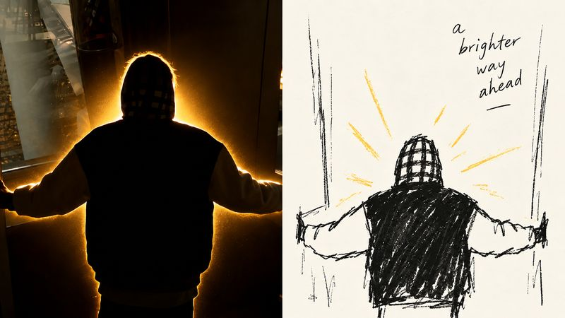</a></td>
    <td width="33%"><a href="https://github.com/nevertoday/xxd-panel-350">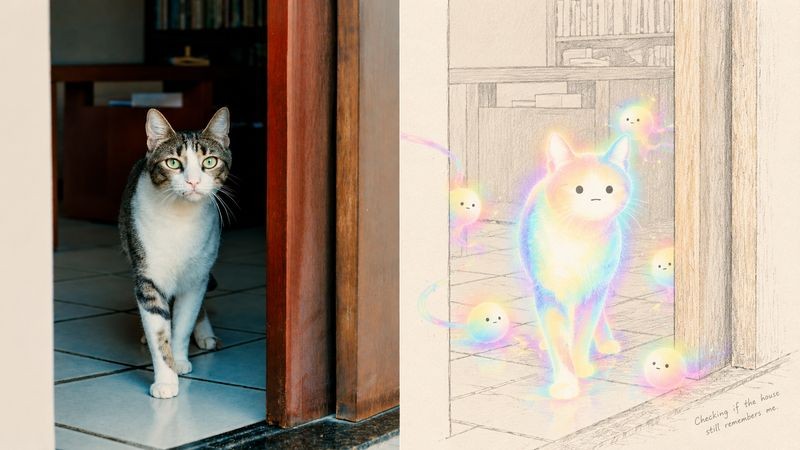</a></td>
  </tr>
</table>

## ما هذا

لوحات XXD Panel مهارات ذكاء اصطناعي تعيد رسم الصور ملصقاتٍ ورسوماً وخلفيات، لكل رقم أسلوب مستقل، وعددها حتى الآن 354. و`xxd-panel-all` هو مدخلها الرئيسي، ويعمل مع Claude Code وCodex وغيرهما من الوكلاء الداعمين للمهارات:

- **يختار لك:** أعطه صورة أو موضوعاً فيقترح أسلوباً أو ثلاثة من الأساليب المثبّتة لديك، مع سبب ملاءمة كل منها.
- **يقارن:** يصنع الصورة نفسها بعدة أساليب لتراها جنباً إلى جنب.
- **يعالج الدفعات:** أعطه مجلداً: أسلوب واحد للجميع، أو الأسلوب الأنسب لكل صورة.
- **لا يرسم بنفسه:** مهارات الأساليب المرقّمة هي التي تصنع الصور. الفهرس يختار ويسلّم فقط، ولا يمزج الأساليب.

## ابدأ في ثلاث خطوات

**1. ثبّت الفهرس وبعض الأساليب التي تعجبك.** يمكنه وصف الأساليب غير المثبّتة واقتراحها، لكن الصور لا تُصنع إلا بالأساليب المثبّتة:

```bash
npx skills add https://github.com/nevertoday/xxd-panel-all --skill xxd-panel-all
npx skills add https://github.com/nevertoday/xxd-panel-001 --skill xxd-panel-001
```

عدة أساليب دفعة واحدة:

```bash
for n in 001 062 350; do npx skills add https://github.com/nevertoday/xxd-panel-$n --skill xxd-panel-$n; done
```

ثم أعد تشغيل جلسة الوكيل.

**2. تأكد أن وكيلك يستطيع توليد الصور.** لا تحتوي هذه المهارة على نموذج صور خاص بها، بل تستخدم قدرة وكيلك على توليد الصور، ويُفضَّل GPT Image 2.

- يعمل Codex مباشرة عندما يكون توليد الصور المدمج مفعّلاً.
- أما Claude Code والوكلاء الذين لا يملكون توليد صور مدمجاً فيحتاجون إلى واجهة صور متوافقة مع OpenAI، ويستغرق الإعداد نحو خمس دقائق: راجع [إعداد توليد الصور](#إعداد-توليد-الصور).

لست متأكداً؟ جرّب مباشرة. إذا تعذّر التوليد فستتوقف المهارة وتخبرك قبل أن تبدأ أي عمل.

**3. أرسل صورة وقل جملة واحدة:**

> استخدم xxd-panel-all لاقتراح ثلاثة أساليب تناسب هذه الصورة مع السبب.

بعد أن تختار، تُسلَّم الصورة إلى مهارة ذلك الأسلوب، فتسألك عن التخطيط والنسبة والنص. تُحفظ النتائج في `~/Desktop/xxd/xxd-panel-NNN/`.

## قلها ببساطة

لا حاجة إلى حفظ المعاملات. قل ما تريد:

| تريد | قل |
|---|---|
| اقتراح | أي أسلوب يناسب هذه الصورة؟ اقترح ثلاثة مع السبب |
| البحث بالإحساس | هل توجد أساليب بخطوط سوداء وفراغ كثير؟ |
| البحث بالغرض | أي الأساليب تناسب خلفية هاتف؟ |
| رقم محدد | استخدم 062 لهذه الصورة |
| مقارنة | اصنع واحدة بكل من 001 و062 و350 لأقارن |
| مجلد بأسلوب واحد | حوّل هذا المجلد كله إلى مقارنات علوية سفلية بالأسلوب 014 |
| مجلد بمطابقة تلقائية | اختر الأسلوب الأنسب لكل صورة في هذا المجلد |
| مثل المرة السابقة | استخدم إعداداتي السابقة |

## كل الأساليب

المجموع 354. كل صورة نموذج مقارنة جانبية واحد من ذلك الأسلوب (الصورة يساراً والتصميم يميناً). انقر عليها لفتح مستودع الأسلوب ورؤية مزيد من النماذج وطريقة الاستخدام.

<!-- xxd-soldier-roster:start -->

<details open>
<summary><strong>001–050</strong></summary>

<table>
  <tr>
    <td width="33%" valign="top"><a href="https://github.com/nevertoday/xxd-panel-001"></a><br><a href="https://github.com/nevertoday/xxd-panel-001"><strong>001</strong> · دفتر الطرافة الرجعية</a><br><sub>يحوّل الصورة إلى رسم يدوي رجعي خفيف بملمس الورق، فيه شيء من البساطة الخرقاء والطرافة.</sub></td>
    <td width="33%" valign="top"><a href="https://github.com/nevertoday/xxd-panel-002"></a><br><a href="https://github.com/nevertoday/xxd-panel-002"><strong>002</strong> · باوهاوس المرحة</a><br><sub>يحوّل الصورة إلى رسم تحريري رجعي فيه لمسة من هندسة باوهاوس وخطوط مرتعشة وطباعة منزاحة.</sub></td>
    <td width="33%" valign="top"><a href="https://github.com/nevertoday/xxd-panel-003"></a><br><a href="https://github.com/nevertoday/xxd-panel-003"><strong>003</strong> · لغة الخط المشدود</a><br><sub>يجمع الاتجاه والصلة والضغط والانفراج في الصورة داخل خط أسود متصل هادئ ومشدود.</sub></td>
  </tr>
  <tr>
    <td width="33%" valign="top"><a href="https://github.com/nevertoday/xxd-panel-004">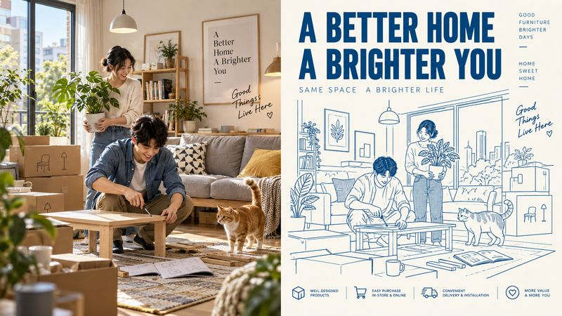</a><br><a href="https://github.com/nevertoday/xxd-panel-004"><strong>004</strong> · دفتر خط المدينة الواحد</a><br><sub>يختصر مشهداً حقيقياً من مدينة أو مكان في ملصق خطي حديث بخطوط مفردة دقيقة ومنظور هندسي واضح.</sub></td>
    <td width="33%" valign="top"><a href="https://github.com/nevertoday/xxd-panel-005"></a><br><a href="https://github.com/nevertoday/xxd-panel-005"><strong>005</strong> · نسخة الحكاية المظلمة</a><br><sub>يختصر الصورة في مطبوعة حكايات تلفّها أشكال داكنة كبيرة، مع ومضات صغيرة من لون زاهٍ.</sub></td>
    <td width="33%" valign="top"><a href="https://github.com/nevertoday/xxd-panel-006">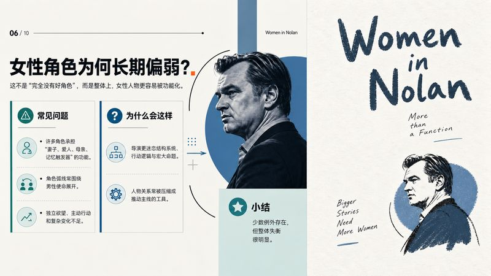</a><br><a href="https://github.com/nevertoday/xxd-panel-006"><strong>006</strong> · مسرح الفراغ الصغير</a><br><sub>يختزل الصورة في عنصر صغير واحد وسط مساحة واسعة من الورق، كغلاف كتاب فني.</sub></td>
  </tr>
  <tr>
    <td width="33%" valign="top"><a href="https://github.com/nevertoday/xxd-panel-007"></a><br><a href="https://github.com/nevertoday/xxd-panel-007"><strong>007</strong> · صفحة الملاحظة المرسومة يدويًا</a><br><sub>يفكّك الصورة إلى صفحة ملاحظات من رسوم صغيرة ومقاطع عرضية وعبارات بخط اليد.</sub></td>
    <td width="33%" valign="top"><a href="https://github.com/nevertoday/xxd-panel-008">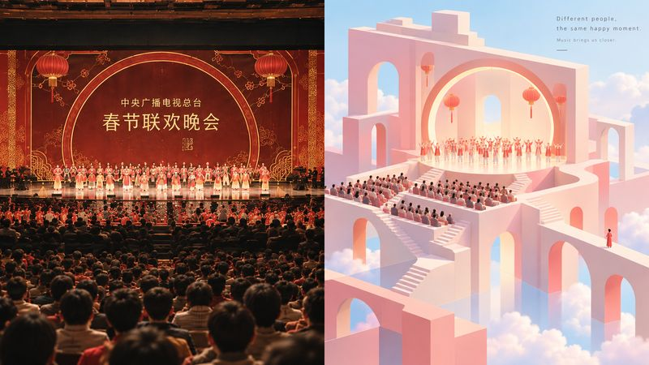</a><br><a href="https://github.com/nevertoday/xxd-panel-008"><strong>008</strong> · أرض الأحلام الباستيلية</a><br><sub>يحوّل أشخاص الصورة وحكايتها إلى فضاء مستحيل بألوان الباستيل، مشرق وهادئ على طريقة Monument Valley.</sub></td>
    <td width="33%" valign="top"><a href="https://github.com/nevertoday/xxd-panel-009">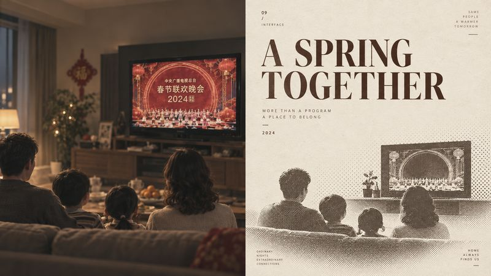</a><br><a href="https://github.com/nevertoday/xxd-panel-009"><strong>009</strong> · طبعة الترسيخ النقطية</a><br><sub>يختصر الصورة في نقطة ارتكاز صغيرة جداً على ورق واسع، بنقاط شبكية تتلاشى من الكثيف إلى المتفرّق لتصنع المسافة والهواء.</sub></td>
  </tr>
  <tr>
    <td width="33%" valign="top"><a href="https://github.com/nevertoday/xxd-panel-010">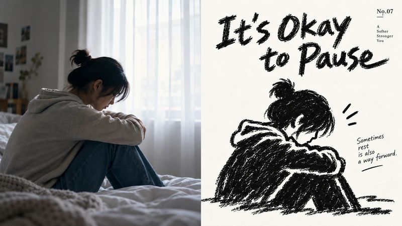</a><br><a href="https://github.com/nevertoday/xxd-panel-010"><strong>010</strong> · كتاب الأطفال القديم بالأبيض والأسود</a><br><sub>يختصر الصورة في ظلّ أسود خشن مرسوم بقلم شمع على ورق شبه أبيض، كصفحة من كتاب أطفال، بالأسود والأبيض فقط.</sub></td>
    <td width="33%" valign="top"><a href="https://github.com/nevertoday/xxd-panel-011">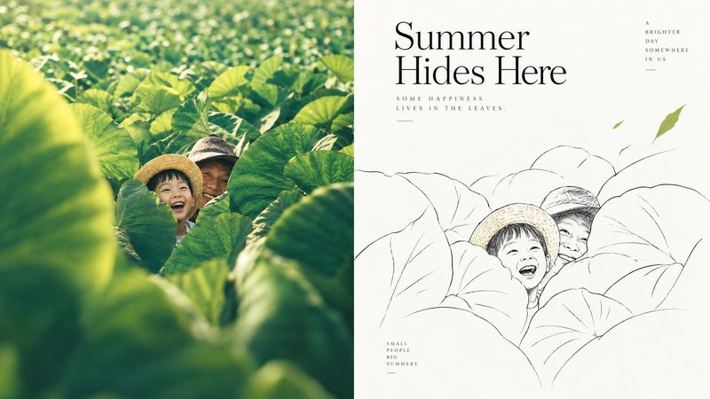</a><br><a href="https://github.com/nevertoday/xxd-panel-011"><strong>011</strong> · قصيدة الخط التأملي</a><br><sub>يختصر الصورة في خط أسود رفيع متصل يُتأمَّل على مهل، مع لمسة لون واحدة ذات معنى.</sub></td>
    <td width="33%" valign="top"><a href="https://github.com/nevertoday/xxd-panel-012">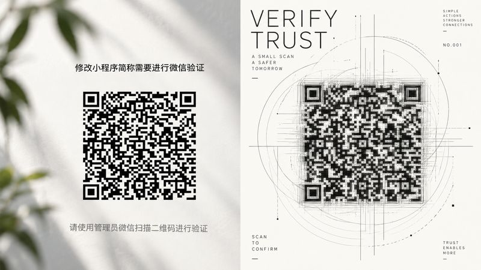</a><br><a href="https://github.com/nevertoday/xxd-panel-012"><strong>012</strong> · هندسة الحياة</a><br><sub>يجعل عنصر الصورة يتجمّع ويظهر من حقل كثيف من خطوط بلون واحد، تحيط به خطوط رفيعة بنظام هندسي.</sub></td>
  </tr>
  <tr>
    <td width="33%" valign="top"><a href="https://github.com/nevertoday/xxd-panel-013">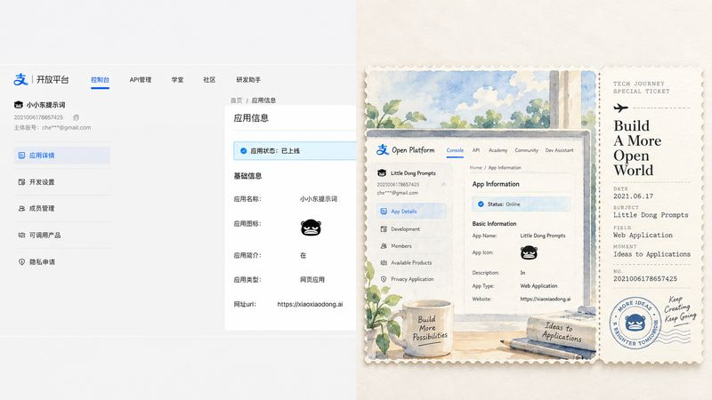</a><br><a href="https://github.com/nevertoday/xxd-panel-013"><strong>013</strong> · ألبوم تذاكر السفر</a><br><sub>يحفظ صورتك في تذكرة نصفها الأيسر رسم مائي ونصفها الأيمن قسيمة، كتذكار سفر محفوظ بعناية.</sub></td>
    <td width="33%" valign="top"><a href="https://github.com/nevertoday/xxd-panel-014">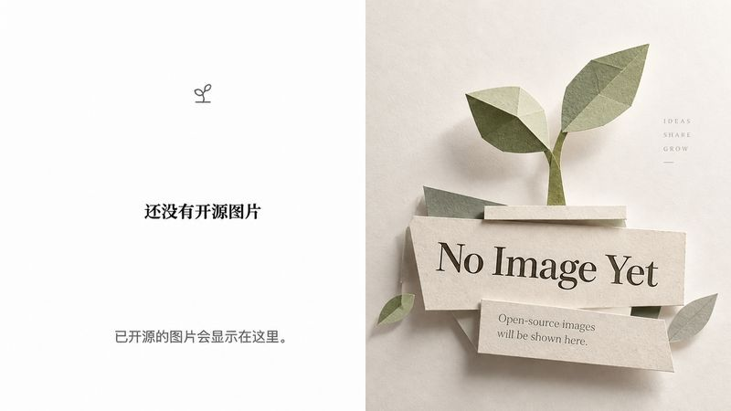</a><br><a href="https://github.com/nevertoday/xxd-panel-014"><strong>014</strong> · دفتر النقش الورقي البارز</a><br><sub>يعيد بناء الصورة منحوتةً معاصرة من الورق المطوي تظهر فيها الثنيات وحواف القص وألياف الورق.</sub></td>
    <td width="33%" valign="top"><a href="https://github.com/nevertoday/xxd-panel-015">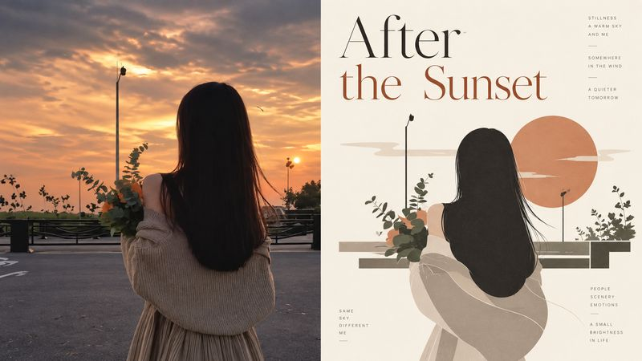</a><br><a href="https://github.com/nevertoday/xxd-panel-015"><strong>015</strong> · مذكرات تجريدية</a><br><sub>يفكّك الصورة وينتقي منها ويعيد بناءها من أشكال هندسية قليلة ومنظومة نصية تحريرية دقيقة، كصفحة من كتاب فني.</sub></td>
  </tr>
  <tr>
    <td width="33%" valign="top"><a href="https://github.com/nevertoday/xxd-panel-016">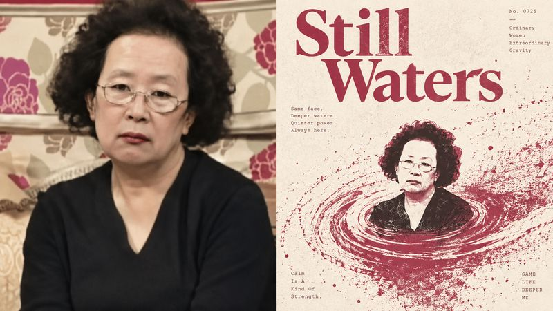</a><br><a href="https://github.com/nevertoday/xxd-panel-016"><strong>016</strong> · مطبوعة خشبية ديناميكية</a><br><sub>يختصر ما يحدث فعلاً في الصورة في عنصر صغير جداً وحقل حركة واحد يحيط به.</sub></td>
    <td width="33%" valign="top"><a href="https://github.com/nevertoday/xxd-panel-017"></a><br><a href="https://github.com/nevertoday/xxd-panel-017"><strong>017</strong> · دفتر الرسم الطفولي</a><br><sub>يحوّل الصورة إلى رسم تحريري كوري مسطّح مشرق بخطوط سوداء خشنة وألوان مصمتة.</sub></td>
    <td width="33%" valign="top"><a href="https://github.com/nevertoday/xxd-panel-018">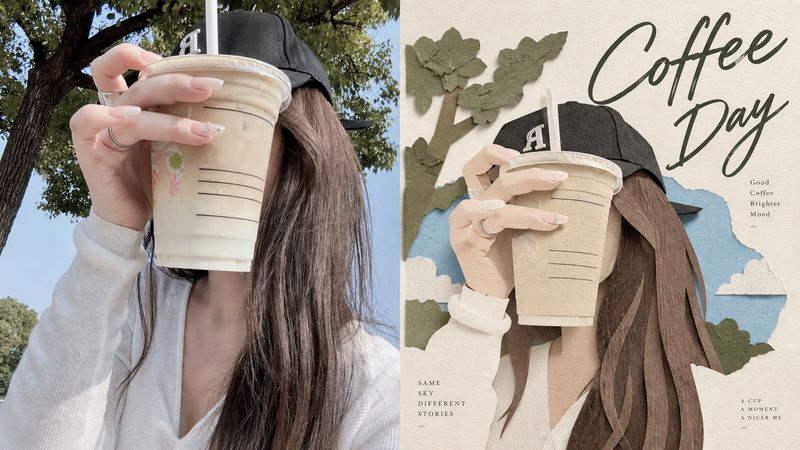</a><br><a href="https://github.com/nevertoday/xxd-panel-018"><strong>018</strong> · دفتر قص الورق اليدوي</a><br><sub>يعيد صنع الصورة ورقاً مقصوصاً بطبقات: عنصر ورقي واحد وطبقات قليلة أمامية ووسطى وخلفية وكتابة صغيرة دقيقة.</sub></td>
  </tr>
  <tr>
    <td width="33%" valign="top"><a href="https://github.com/nevertoday/xxd-panel-019">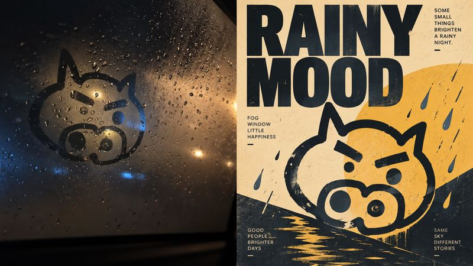</a><br><a href="https://github.com/nevertoday/xxd-panel-019"><strong>019</strong> · دفتر الغرافيك الرجعي</a><br><sub>يعيد بناء عنصر الصورة وعلاقاته في رسم مسطّح حداثي رجعي يبقى قابلاً للتعرّف.</sub></td>
    <td width="33%" valign="top"><a href="https://github.com/nevertoday/xxd-panel-020">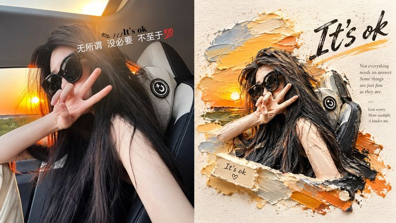</a><br><a href="https://github.com/nevertoday/xxd-panel-020"><strong>020</strong> · منظر مصغّر بطلاء سميك</a><br><sub>يحوّل عنصر الصورة وحكايتها إلى مشهد مصغّر مجسّم يكاد يُلمس، ينمو من كتلة طلاء سميك.</sub></td>
    <td width="33%" valign="top"><a href="https://github.com/nevertoday/xxd-panel-021">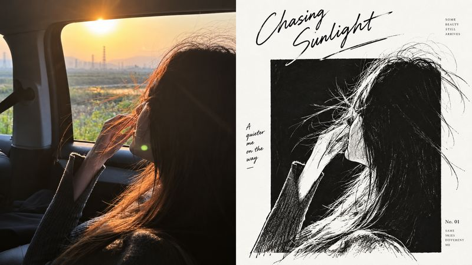</a><br><a href="https://github.com/nevertoday/xxd-panel-021"><strong>021</strong> · تجاوز الحقل الأسود</a><br><sub>يجعل عنصر الصورة يطلّ خارجاً من مستطيل أسود خالص، مرسوماً بخط أسود مرتعش وأشكال بيضاء، بالأسود والأبيض والرمادي فقط.</sub></td>
  </tr>
  <tr>
    <td width="33%" valign="top"><a href="https://github.com/nevertoday/xxd-panel-022">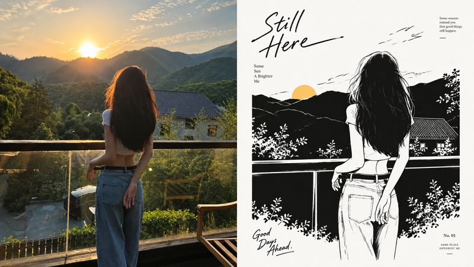</a><br><a href="https://github.com/nevertoday/xxd-panel-022"><strong>022</strong> · تجاوز النقاط الملونة</a><br><sub>يجعل عنصر الصورة يتجاوز مستطيلاً أسود خالصاً بخط نظيف، مع لون في موضع واحد مهم فقط.</sub></td>
    <td width="33%" valign="top"><a href="https://github.com/nevertoday/xxd-panel-023">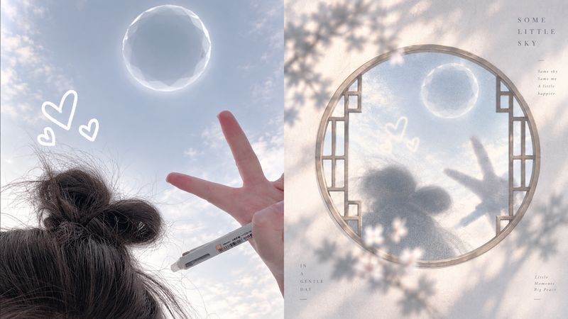</a><br><a href="https://github.com/nevertoday/xxd-panel-023"><strong>023</strong> · مشهد النافذة الشرقية</a><br><sub>يضع صورتك في نافذة صينية تُختار لتناسبها، كأن ضوء الشمس يسقط عبر المشربية على جدار فاتح.</sub></td>
    <td width="33%" valign="top"><a href="https://github.com/nevertoday/xxd-panel-024"></a><br><a href="https://github.com/nevertoday/xxd-panel-024"><strong>024</strong> · نافذة المشاعر</a><br><sub>يجعل عنصراً حقيقياً من صورتك يعبر نافذة هندسية ضيقة فاتحة، في ملصق تجاري راقٍ بسيط.</sub></td>
  </tr>
  <tr>
    <td width="33%" valign="top"><a href="https://github.com/nevertoday/xxd-panel-025">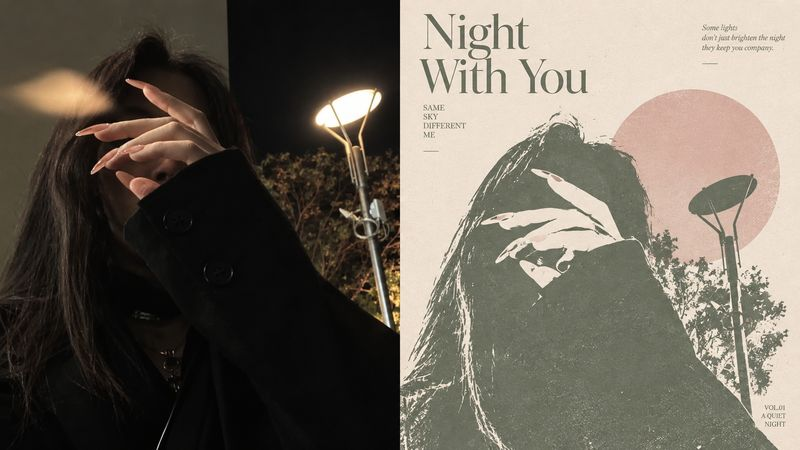</a><br><a href="https://github.com/nevertoday/xxd-panel-025"><strong>025</strong> · صور خفية</a><br><sub>يحوّل الصورة إلى مطبوعة حريرية بألوان موراندي، ترى فيها العنصر أولاً ثم تكتشف في النظرة الثانية صورة مخبّأة.</sub></td>
    <td width="33%" valign="top"><a href="https://github.com/nevertoday/xxd-panel-026">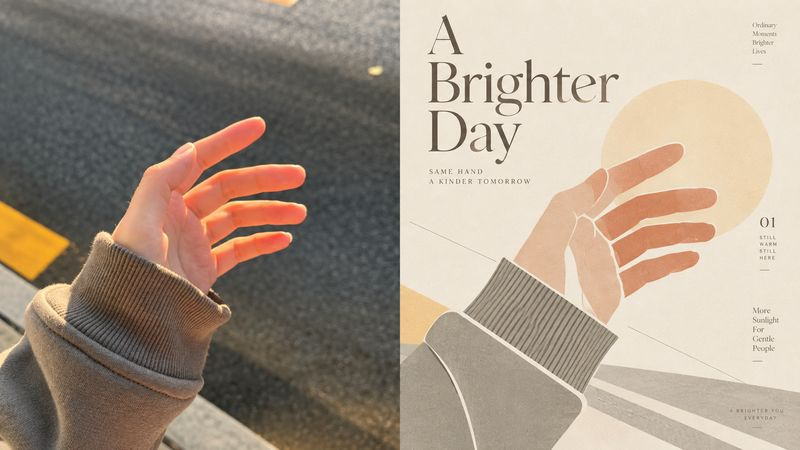</a><br><a href="https://github.com/nevertoday/xxd-panel-026"><strong>026</strong> · نظام هندسي</a><br><sub>يترجم وقائع الصورة إلى هندسة هادئة لطيفة يبقى عنصرها معروفاً من النظرة الأولى.</sub></td>
    <td width="33%" valign="top"><a href="https://github.com/nevertoday/xxd-panel-027">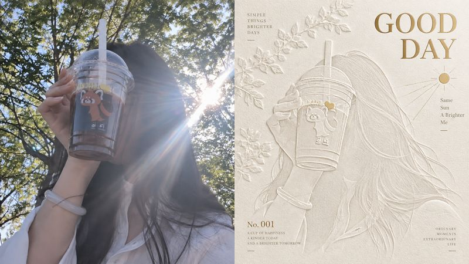</a><br><a href="https://github.com/nevertoday/xxd-panel-027"><strong>027</strong> · نقش بارز على الورق</a><br><sub>يطبع الصورة نقشاً بارزاً خفيفاً على طريقة المتاحف الشرقية فوق ورق عاجي سميك، مع ذهبي مطفأ في الموضع المهم فقط.</sub></td>
  </tr>
  <tr>
    <td width="33%" valign="top"><a href="https://github.com/nevertoday/xxd-panel-028">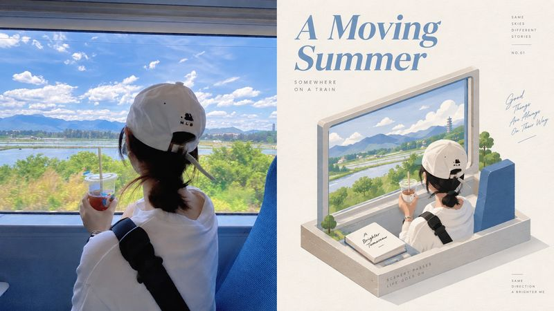</a><br><a href="https://github.com/nevertoday/xxd-panel-028"><strong>028</strong> · منظر مصغّر متساوي القياس</a><br><sub>يضع صورتك نموذجاً مصغّراً متساوي القياس على الورق بألوانها نفسها، كمجسّم معماري صغير.</sub></td>
    <td width="33%" valign="top"><a href="https://github.com/nevertoday/xxd-panel-029">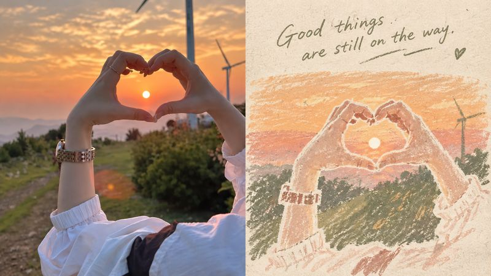</a><br><a href="https://github.com/nevertoday/xxd-panel-029"><strong>029</strong> · رسم بطيء على الورق</a><br><sub>يعيد رسم الصورة بقلم الباستيل الشمعي بحرية فوق مساحة لونية أفقية باهتة، مع سطر واحد مكتوب باليد على عجل.</sub></td>
    <td width="33%" valign="top"><a href="https://github.com/nevertoday/xxd-panel-030">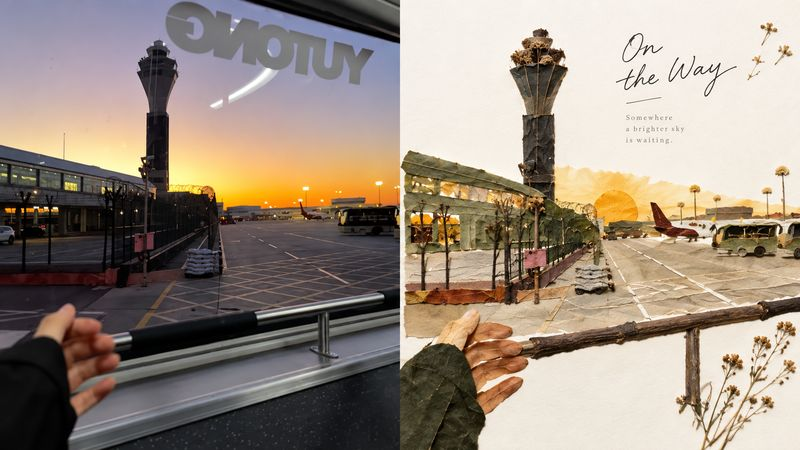</a><br><a href="https://github.com/nevertoday/xxd-panel-030"><strong>030</strong> · طبيعة بلا حدود</a><br><sub>يعيد بناء عنصر الصورة من أوراق شجر وبتلات وأغصان وثمار وبذور وسيقان عشب ولحاء حقيقية.</sub></td>
  </tr>
  <tr>
    <td width="33%" valign="top"><a href="https://github.com/nevertoday/xxd-panel-031">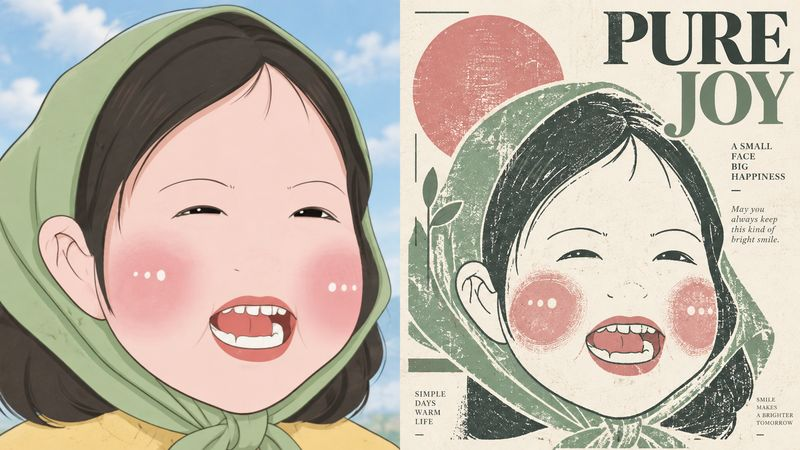</a><br><a href="https://github.com/nevertoday/xxd-panel-031"><strong>031</strong> · نقش رمزي بالفرك</a><br><sub>يقرأ المعنى الكامن وراء الصورة أولاً، ثم يختصره في نقش هندسي واحد بملمس الفرك الشعبي الخشن.</sub></td>
    <td width="33%" valign="top"><a href="https://github.com/nevertoday/xxd-panel-032">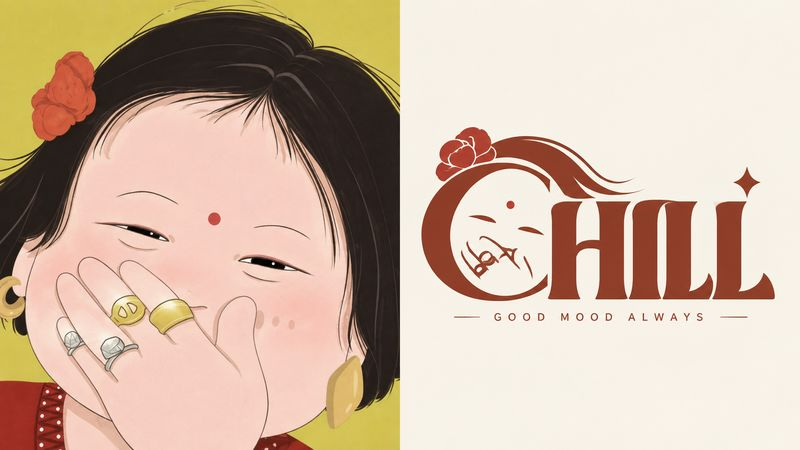</a><br><a href="https://github.com/nevertoday/xxd-panel-032"><strong>032</strong> · علامة نصية رسومية</a><br><sub>يدمج السمة الأوضح في موضوع صورتك داخل حروف علامة نصية مصممة خصيصاً.</sub></td>
    <td width="33%" valign="top"><a href="https://github.com/nevertoday/xxd-panel-033">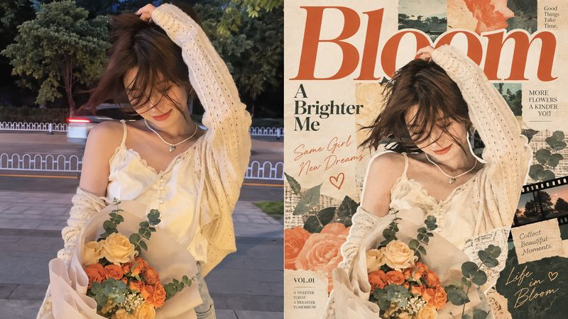</a><br><a href="https://github.com/nevertoday/xxd-panel-033"><strong>033</strong> · دفتر الكولاج الزاهي</a><br><sub>يحوّل صورة واحدة إلى كولاج غلاف مجلة حديث، زاهٍ ومشبع الألوان وواضح الطبقات.</sub></td>
  </tr>
  <tr>
    <td width="33%" valign="top"><a href="https://github.com/nevertoday/xxd-panel-034">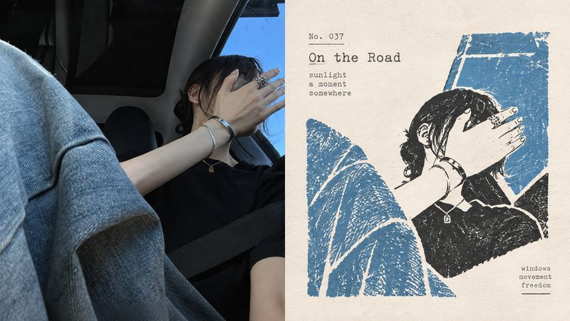</a><br><a href="https://github.com/nevertoday/xxd-panel-034"><strong>034</strong> · أختام السفر</a><br><sub>يختزل الصورة إلى ختم مطاطي صغير متعدد الألوان ترافقه ملاحظة ميدانية هادئة.</sub></td>
    <td width="33%" valign="top"><a href="https://github.com/nevertoday/xxd-panel-035">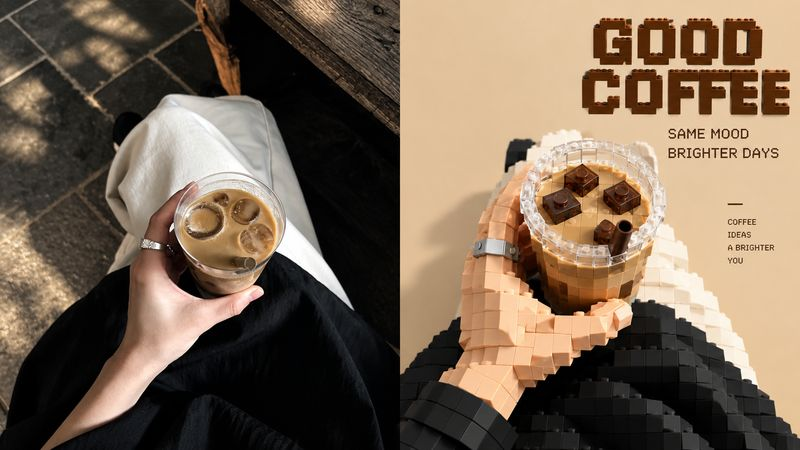</a><br><a href="https://github.com/nevertoday/xxd-panel-035"><strong>035</strong> · إعادة بناء المكعبات</a><br><sub>يعيد بناء موضوع صورتك قطعةً واحدة زاهية من مكعبات فوكسل تُعرف من النظرة الأولى.</sub></td>
    <td width="33%" valign="top"><a href="https://github.com/nevertoday/xxd-panel-036">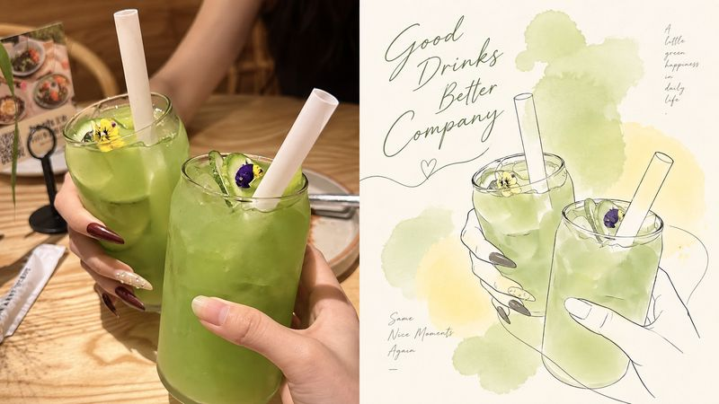</a><br><a href="https://github.com/nevertoday/xxd-panel-036"><strong>036</strong> · كتاب مصوّر انسيابي</a><br><sub>يرسم العلاقة في صورتك ببضعة خطوط رفيعة متصلة، ويترك ألواناً شفافة تنساب ببطء على الورق.</sub></td>
  </tr>
  <tr>
    <td width="33%" valign="top"><a href="https://github.com/nevertoday/xxd-panel-037"></a><br><a href="https://github.com/nevertoday/xxd-panel-037"><strong>037</strong> · شعار الذهب المتدفق</a><br><sub>يحوّل صورة من رحلتك إلى شارة مينا مذهّبة واحدة تستحق الاقتناء.</sub></td>
    <td width="33%" valign="top"><a href="https://github.com/nevertoday/xxd-panel-038">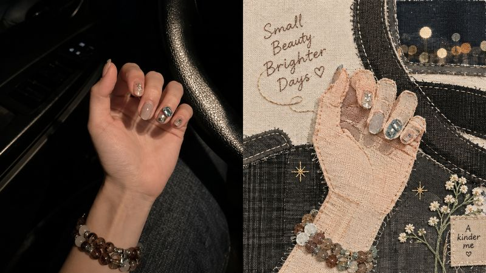</a><br><a href="https://github.com/nevertoday/xxd-panel-038"><strong>038</strong> · دفتر حياة النسيج</a><br><sub>يخيط صورتك والإحساس الذي لا تقوله في لوحة رقع دافئة مصنوعة باليد.</sub></td>
    <td width="33%" valign="top"><a href="https://github.com/nevertoday/xxd-panel-039">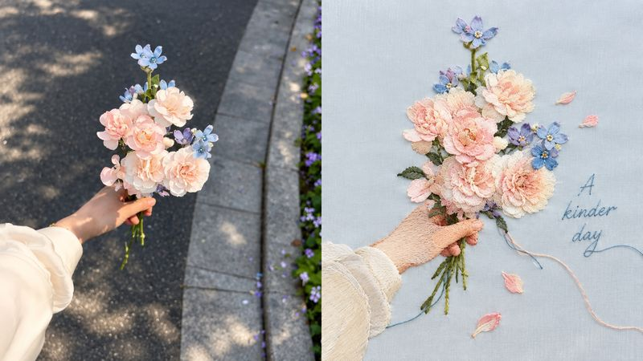</a><br><a href="https://github.com/nevertoday/xxd-panel-039"><strong>039</strong> · صور مطرزة</a><br><sub>يختار من صورتك الصورة الوحيدة الأجدر بالبقاء ويطرّزها في لمعان حريري حيّ.</sub></td>
  </tr>
  <tr>
    <td width="33%" valign="top"><a href="https://github.com/nevertoday/xxd-panel-040">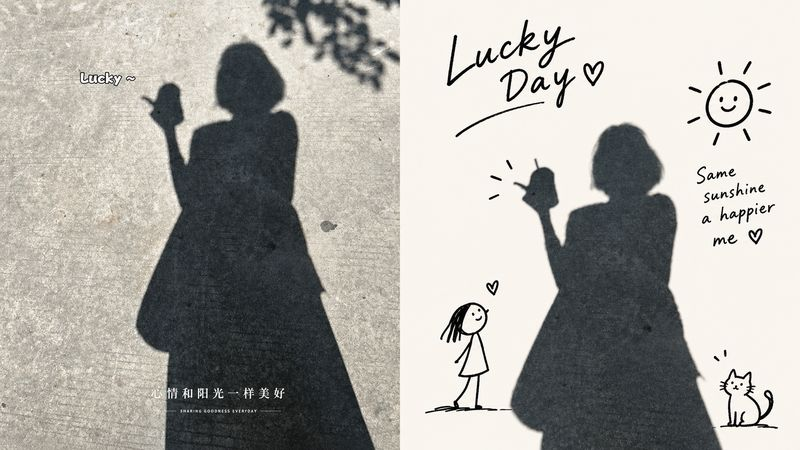</a><br><a href="https://github.com/nevertoday/xxd-panel-040"><strong>040</strong> · رفيق الخربشة</a><br><sub>يُبقي الشيء الحقيقي الأجدر بالتذكّر في صورتك، ويترك شخوصاً مخربشة بخطوط سوداء تمثّل حوله حكاية صغيرة.</sub></td>
    <td width="33%" valign="top"><a href="https://github.com/nevertoday/xxd-panel-041">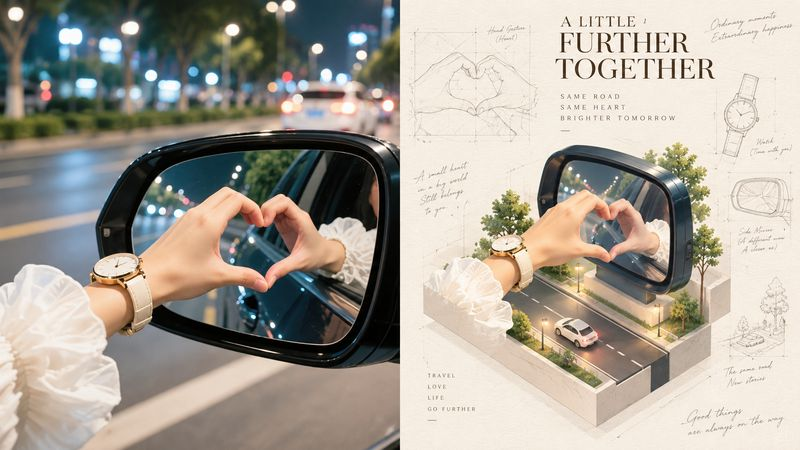</a><br><a href="https://github.com/nevertoday/xxd-panel-041"><strong>041</strong> · مختبر متساوي القياس</a><br><sub>يبني موضوع صورتك وفكرة واحدة مستمدة منها في دراسة إيزومترية صافية الألوان.</sub></td>
    <td width="33%" valign="top"><a href="https://github.com/nevertoday/xxd-panel-042">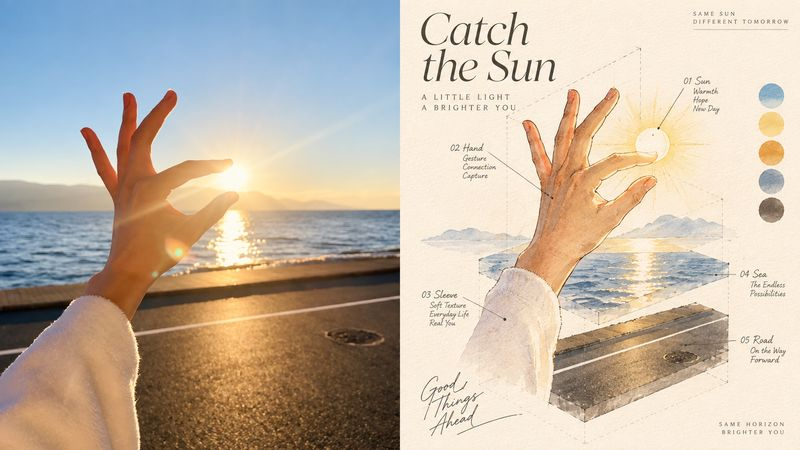</a><br><a href="https://github.com/nevertoday/xxd-panel-042"><strong>042</strong> · دفتر الألوان المائية المُفكَّكة</a><br><sub>يفتح موضوع صورتك طبقةً طبقة على امتداد بنيته الحقيقية، مرسوماً كدراسة مائية يمكن إعادة تجميعها.</sub></td>
  </tr>
  <tr>
    <td width="33%" valign="top"><a href="https://github.com/nevertoday/xxd-panel-043">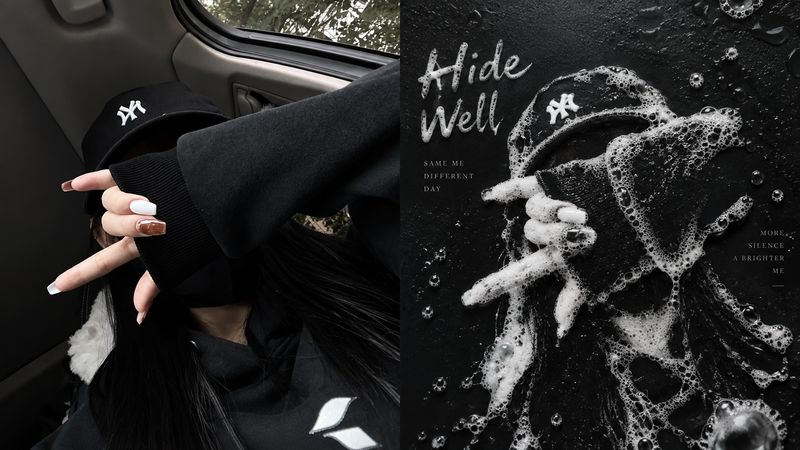</a><br><a href="https://github.com/nevertoday/xxd-panel-043"><strong>043</strong> · رغوة بيضاء</a><br><sub>يعيد رسم موضوع صورتك برغوة صابون بيضاء حقيقية على سطح مستوٍ داكن ورطب.</sub></td>
    <td width="33%" valign="top"><a href="https://github.com/nevertoday/xxd-panel-044">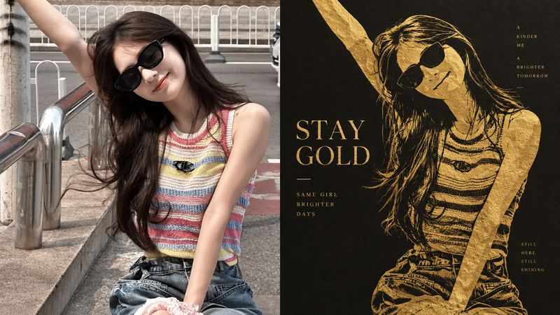</a><br><a href="https://github.com/nevertoday/xxd-panel-044"><strong>044</strong> · ذهب خالص مسطّح</a><br><sub>يضغط الشكل الحاسم لموضوع صورتك في طبقة رقيقة من الذهب الخالص على أرضية داكنة.</sub></td>
    <td width="33%" valign="top"><a href="https://github.com/nevertoday/xxd-panel-045">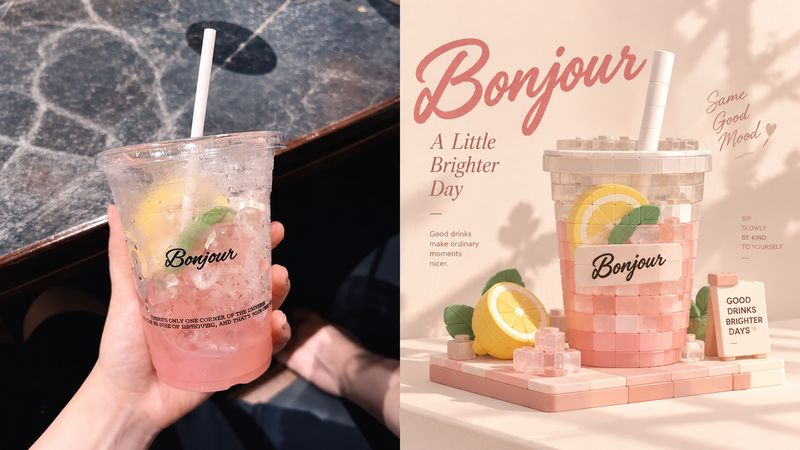</a><br><a href="https://github.com/nevertoday/xxd-panel-045"><strong>045</strong> · مدينة المكعبات المريحة</a><br><sub>يعيد بناء موضوع صورتك منحوتةَ مكعبات مستديرة تغري باللمس وبألوان لطيفة.</sub></td>
  </tr>
  <tr>
    <td width="33%" valign="top"><a href="https://github.com/nevertoday/xxd-panel-046">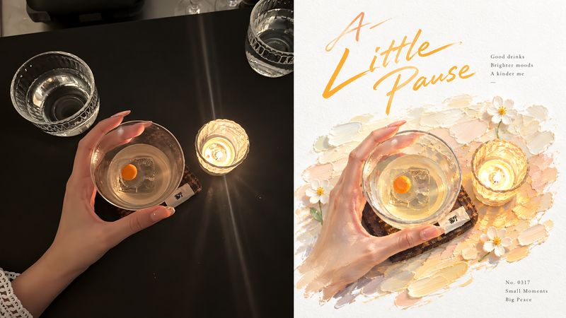</a><br><a href="https://github.com/nevertoday/xxd-panel-046"><strong>046</strong> · عالم مصغّر بطلاء سميك</a><br><sub>يعيد بناء صورتك منظراً مصغّراً مشرقاً نابضاً تكاد تلمس سماكة طلائه.</sub></td>
    <td width="33%" valign="top"><a href="https://github.com/nevertoday/xxd-panel-047">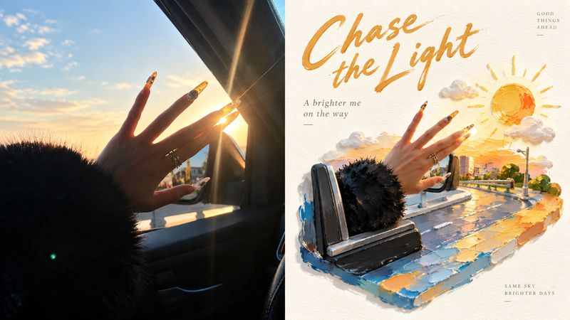</a><br><a href="https://github.com/nevertoday/xxd-panel-047"><strong>047</strong> · مشهد متساوي القياس بطلاء سميك</a><br><sub>يحوّل موضوع صورتك إلى مجسّم إيزومتري مصغّر دقيق يقف داخل حقل حي من الطلاء الكثيف.</sub></td>
    <td width="33%" valign="top"><a href="https://github.com/nevertoday/xxd-panel-048">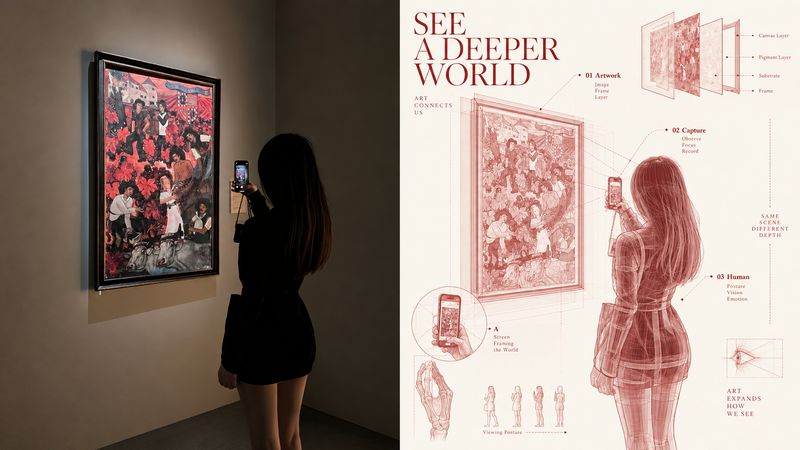</a><br><a href="https://github.com/nevertoday/xxd-panel-048"><strong>048</strong> · دفتر البنية الشفافة</a><br><sub>يجعل موضوع صورتك شبه شفاف ويرسم منطق بنيته في مخطط صافٍ.</sub></td>
  </tr>
  <tr>
    <td width="33%" valign="top"><a href="https://github.com/nevertoday/xxd-panel-049">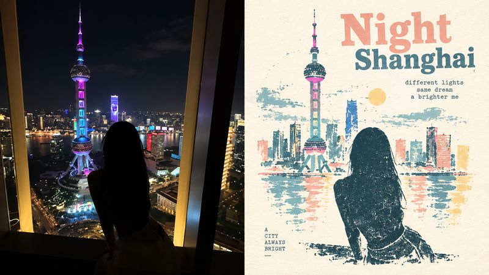</a><br><a href="https://github.com/nevertoday/xxd-panel-049"><strong>049</strong> · أثر الحفر الخشبي</a><br><sub>يحفر أكثر ما يؤثر في صورتك في طبعة خشبية منعشة ناعمة محدودة الألوان.</sub></td>
    <td width="33%" valign="top"><a href="https://github.com/nevertoday/xxd-panel-050">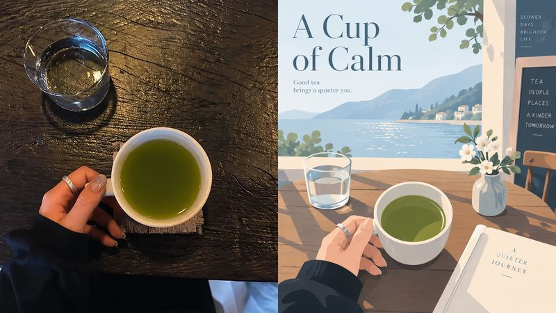</a><br><a href="https://github.com/nevertoday/xxd-panel-050"><strong>050</strong> · بطاقة بريدية للسفر</a><br><sub>يحوّل كل صورة إلى ملصق سفر بسيط خاص بها بلون أزرق هوائي.</sub></td>
  </tr>
</table>

</details>

<details>
<summary><strong>051–100</strong></summary>

<table>
  <tr>
    <td width="33%" valign="top"><a href="https://github.com/nevertoday/xxd-panel-051"></a><br><a href="https://github.com/nevertoday/xxd-panel-051"><strong>051</strong> · جزيرة مصغّرة يدوية الصنع</a><br><sub>يحوّل موضوع صورتك إلى مجسّم ورقي مصغّر مصنوع يدوياً، خفيف ويغري باللمس.</sub></td>
    <td width="33%" valign="top"><a href="https://github.com/nevertoday/xxd-panel-052">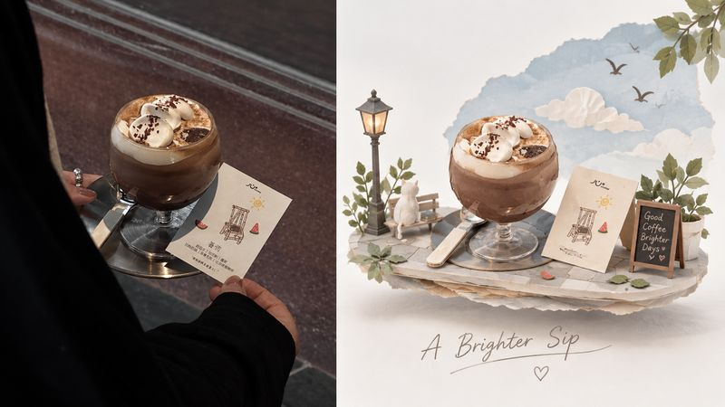</a><br><a href="https://github.com/nevertoday/xxd-panel-052"><strong>052</strong> · جزيرة مصغّرة من فن الورق</a><br><sub>يحوّل العالم في صورتك إلى عالم ورقي مصغّر مصنوع يدوياً يطفو بهدوء على خط منظر واحد.</sub></td>
    <td width="33%" valign="top"><a href="https://github.com/nevertoday/xxd-panel-053">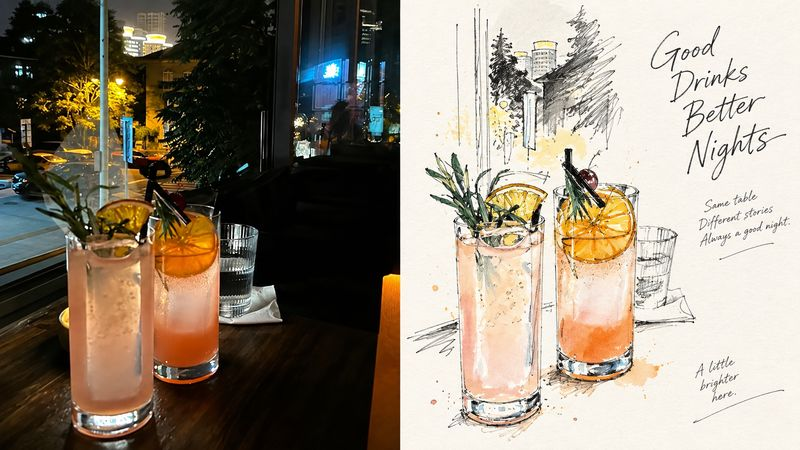</a><br><a href="https://github.com/nevertoday/xxd-panel-053"><strong>053</strong> · سجل القلم والألوان الخفيفة</a><br><sub>يدوّن صورتك بخطوط قلم مُلاحِظة وبضع لمسات لونية خفيفة، ويتوقف في الموضع المناسب تماماً.</sub></td>
  </tr>
  <tr>
    <td width="33%" valign="top"><a href="https://github.com/nevertoday/xxd-panel-054">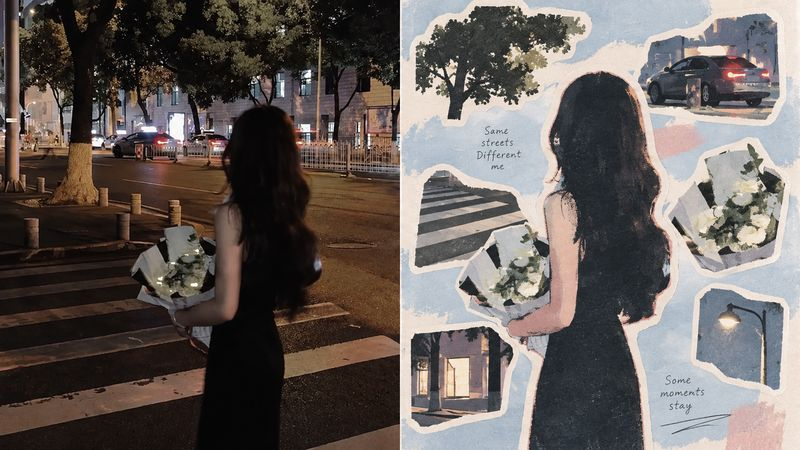</a><br><a href="https://github.com/nevertoday/xxd-panel-054"><strong>054</strong> · ألبوم ملصقات الذكريات</a><br><sub>يقسم ذكرى واحدة إلى صورة رئيسية وستة ملصقات غير متساوية الحجم.</sub></td>
    <td width="33%" valign="top"><a href="https://github.com/nevertoday/xxd-panel-055">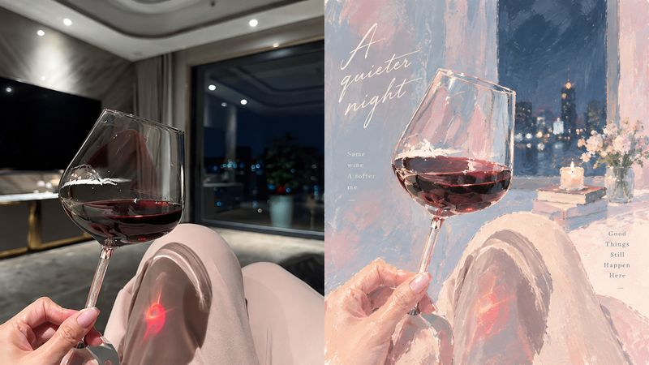</a><br><a href="https://github.com/nevertoday/xxd-panel-055"><strong>055</strong> · حقل الذاكرة المرسوم</a><br><sub>يرسم شعاع ضوء وحركة وعلاقة مكانية من صورتك في لوحة واحدة رقيقة.</sub></td>
    <td width="33%" valign="top"><a href="https://github.com/nevertoday/xxd-panel-056">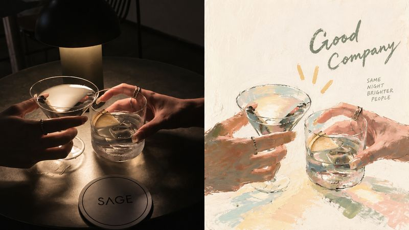</a><br><a href="https://github.com/nevertoday/xxd-panel-056"><strong>056</strong> · لوحة الذاكرة بالفراغ</a><br><sub>يُبقي صورة جوهرية واحدة من صورتك ويعيد رسمها في فراغ شاسع بضربات عفوية وقفزات لونية بين الدافئ والبارد.</sub></td>
  </tr>
  <tr>
    <td width="33%" valign="top"><a href="https://github.com/nevertoday/xxd-panel-057">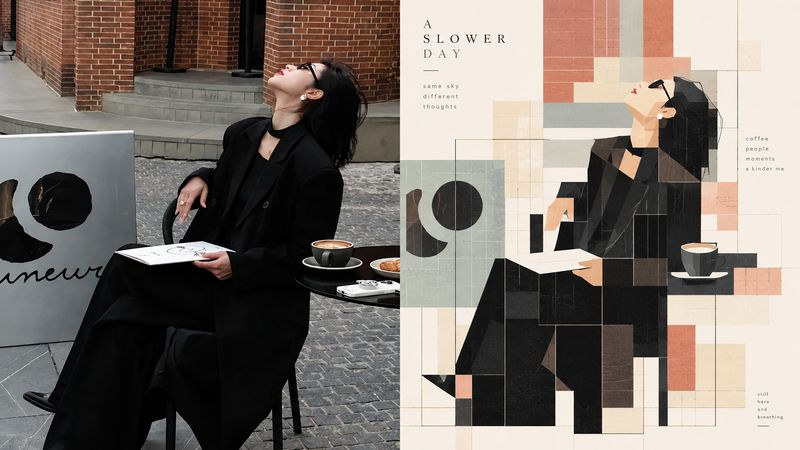</a><br><a href="https://github.com/nevertoday/xxd-panel-057"><strong>057</strong> · حقل الذاكرة الهندسي</a><br><sub>يعيد بناء صورتك كولاجاً حديثاً هادئاً دافئاً من كتل هندسية وفسيفساء منتظمة.</sub></td>
    <td width="33%" valign="top"><a href="https://github.com/nevertoday/xxd-panel-058"></a><br><a href="https://github.com/nevertoday/xxd-panel-058"><strong>058</strong> · مشهد مفاهيمي شاعري</a><br><sub>يقرأ ما تلمّح إليه صورتك ويبنيه بهندسة صارمة في منظر مفاهيمي شاعري.</sub></td>
    <td width="33%" valign="top"><a href="https://github.com/nevertoday/xxd-panel-059"></a><br><a href="https://github.com/nevertoday/xxd-panel-059"><strong>059</strong> · كتاب الخرافات المرسوم يدويًا</a><br><sub>يرسم الحكاية التي لا تقولها صورتك صفحةً من كتاب خرافات دافئ طفولي وذكي بهدوء.</sub></td>
  </tr>
  <tr>
    <td width="33%" valign="top"><a href="https://github.com/nevertoday/xxd-panel-060"></a><br><a href="https://github.com/nevertoday/xxd-panel-060"><strong>060</strong> · قصيدة زِن بسيطة</a><br><sub>يختزل صورتك في شكل إلى ثلاثة أشكال سوداء وفراغ شاسع، تأملاً بصرياً هادئاً يبقى صداه.</sub></td>
    <td width="33%" valign="top"><a href="https://github.com/nevertoday/xxd-panel-061"></a><br><a href="https://github.com/nevertoday/xxd-panel-061"><strong>061</strong> · دفتر الذاكرة البصرية</a><br><sub>يعيد تنظيم صورتك في بضع شذرات ذاكرة متناثرة يتردد بعضها في بعض على الصفحة.</sub></td>
    <td width="33%" valign="top"><a href="https://github.com/nevertoday/xxd-panel-062"></a><br><a href="https://github.com/nevertoday/xxd-panel-062"><strong>062</strong> · خط ذكي وأخرق</a><br><sub>يرسم اللحظة الأجدر بالتذكّر في صورتك بخطوط سوداء عفوية ولون واحد مأخوذ من الصورة.</sub></td>
  </tr>
  <tr>
    <td width="33%" valign="top"><a href="https://github.com/nevertoday/xxd-panel-063"></a><br><a href="https://github.com/nevertoday/xxd-panel-063"><strong>063</strong> · دفتر الاستعارة البكسلية</a><br><sub>يعيد بناء صورتك استعارةً هادئة من محيط بكسلي كبير وبضع كتل لونية ناعمة.</sub></td>
    <td width="33%" valign="top"><a href="https://github.com/nevertoday/xxd-panel-064"></a><br><a href="https://github.com/nevertoday/xxd-panel-064"><strong>064</strong> · صفحة كولاج مستقلة</a><br><sub>يحوّل الصورة إلى صفحة كولاج هادئة ناقصة من ورق قديم، كأنها من أرشيف شخصي.</sub></td>
    <td width="33%" valign="top"><a href="https://github.com/nevertoday/xxd-panel-065"></a><br><a href="https://github.com/nevertoday/xxd-panel-065"><strong>065</strong> · دفتر تحريري بخطين</a><br><sub>يرسم صورتك بهيكل من الخط الأسود ولونين من الصورة ينزاحان كطباعة قديمة بلونين.</sub></td>
  </tr>
  <tr>
    <td width="33%" valign="top"><a href="https://github.com/nevertoday/xxd-panel-066"></a><br><a href="https://github.com/nevertoday/xxd-panel-066"><strong>066</strong> · خط السرد البريء</a><br><sub>يعيد سرد الحركة والعلاقة في صورتك حكايةً طفولية صغيرة بخطوط سوداء مرتخية وألوان مسطّحة ناعمة.</sub></td>
    <td width="33%" valign="top"><a href="https://github.com/nevertoday/xxd-panel-067"></a><br><a href="https://github.com/nevertoday/xxd-panel-067"><strong>067</strong> · رسم الفكاهة اليومية</a><br><sub>يدوّن لحظة طريفة من صورتك صفحةً في دفتر ملاحظات شخصي، مرسومة بالحبر الأحمر والأزرق فقط.</sub></td>
    <td width="33%" valign="top"><a href="https://github.com/nevertoday/xxd-panel-068"></a><br><a href="https://github.com/nevertoday/xxd-panel-068"><strong>068</strong> · ألبوم الرسم الحر الشرقي</a><br><sub>يعيد رسم صورتك بالطريقة الشرقية، بخطوط حبر حرّة وألوان مائية خفيفة ومساحات بيضاء واسعة.</sub></td>
  </tr>
  <tr>
    <td width="33%" valign="top"><a href="https://github.com/nevertoday/xxd-panel-069"></a><br><a href="https://github.com/nevertoday/xxd-panel-069"><strong>069</strong> · نافذة اللطخات الزاهية</a><br><sub>يرسم بضع ضربات فرشاة عريضة نافذةً ملوّنة، ويترك العنصر الرئيسي في صورتك يخرج منها بألوان مشرقة.</sub></td>
    <td width="33%" valign="top"><a href="https://github.com/nevertoday/xxd-panel-070"></a><br><a href="https://github.com/nevertoday/xxd-panel-070"><strong>070</strong> · جزيرة مريحة بطلاء سميك</a><br><sub>يرسم العنصر الرئيسي في صورتك جزيرةً صغيرة مشرقة تستقر وسط مساحة واسعة من الأبيض الدافئ.</sub></td>
    <td width="33%" valign="top"><a href="https://github.com/nevertoday/xxd-panel-071"></a><br><a href="https://github.com/nevertoday/xxd-panel-071"><strong>071</strong> · دفتر الشعر الباستيلي</a><br><sub>يحوّل صورتك إلى بضع شذرات ذكرى بألوان الباستيل تطفو على ورق قريب من الأبيض، مع قصيدة بخط يد مرتخٍ.</sub></td>
  </tr>
  <tr>
    <td width="33%" valign="top"><a href="https://github.com/nevertoday/xxd-panel-072"></a><br><a href="https://github.com/nevertoday/xxd-panel-072"><strong>072</strong> · دفتر الألوان الزاهية</a><br><sub>يجرّد صورتك إلى هندسة مشرقة من الزجاج المصنفر، واضحة في مواضع وضبابية في أخرى.</sub></td>
    <td width="33%" valign="top"><a href="https://github.com/nevertoday/xxd-panel-073"></a><br><a href="https://github.com/nevertoday/xxd-panel-073"><strong>073</strong> · دفتر المدينة الهندسية</a><br><sub>يعيد بناء صورتك نموذجاً معمارياً مصغّراً متساوي القياس، مقطوعاً ومحاطاً بالسقالات.</sub></td>
    <td width="33%" valign="top"><a href="https://github.com/nevertoday/xxd-panel-074"></a><br><a href="https://github.com/nevertoday/xxd-panel-074"><strong>074</strong> · دفتر أيقونات المزاج</a><br><sub>يختزل العنصر الرئيسي ومزاج صورتك في أيقونة واحدة مربعة مستديرة الزوايا، أمامية مطفأة اللمعان ومتعددة الطبقات.</sub></td>
  </tr>
  <tr>
    <td width="33%" valign="top"><a href="https://github.com/nevertoday/xxd-panel-075"></a><br><a href="https://github.com/nevertoday/xxd-panel-075"><strong>075</strong> · رسم بأقلام شمعية داكنة</a><br><sub>يترك الأثر الأجدر بالتذكّر من صورتك بقلم شمعي داكن على ورق يدوي بلون الأبيض المائل إلى الكريم.</sub></td>
    <td width="33%" valign="top"><a href="https://github.com/nevertoday/xxd-panel-076"></a><br><a href="https://github.com/nevertoday/xxd-panel-076"><strong>076</strong> · أقلام شمعية بألوان الماكارون</a><br><sub>يرسم صورتك ذكرى سفر دافئة بقلم شمعي داكن خشن وألوان ماكرون مشرقة.</sub></td>
    <td width="33%" valign="top"><a href="https://github.com/nevertoday/xxd-panel-077"></a><br><a href="https://github.com/nevertoday/xxd-panel-077"><strong>077</strong> · رسم مجلة السفر</a><br><sub>يحوّل صورتك إلى صفحة مجلة سفر من طبقات ورق مقصوص بظلال ناعمة ونص إنجليزي.</sub></td>
  </tr>
  <tr>
    <td width="33%" valign="top"><a href="https://github.com/nevertoday/xxd-panel-078"></a><br><a href="https://github.com/nevertoday/xxd-panel-078"><strong>078</strong> · دفتر مطبوع برقائق الذهب</a><br><sub>يرسم المحيط الأساسي لصورتك بخط رفيع ويضغطه عميقاً في ورق قطني عاجي برقائق ذهب الشامبانيا.</sub></td>
    <td width="33%" valign="top"><a href="https://github.com/nevertoday/xxd-panel-079"></a><br><a href="https://github.com/nevertoday/xxd-panel-079"><strong>079</strong> · دفتر القلم والألوان الخفيفة</a><br><sub>يرسم صورتك مخطّطاً ميدانياً نصف مكتمل من خطوط هندسية وحبر حرّ وبضع لمسات مائية خفيفة.</sub></td>
    <td width="33%" valign="top"><a href="https://github.com/nevertoday/xxd-panel-080"></a><br><a href="https://github.com/nevertoday/xxd-panel-080"><strong>080</strong> · حقل الغواش العضوي</a><br><sub>يضع مزاج صورتك واستعارة صغيرة منها في فراغ واسع، بأشكال عضوية ناعمة وغواش بألوان نباتية.</sub></td>
  </tr>
  <tr>
    <td width="33%" valign="top"><a href="https://github.com/nevertoday/xxd-panel-081"></a><br><a href="https://github.com/nevertoday/xxd-panel-081"><strong>081</strong> · ألبوم ذكريات بالخيوط الملونة</a><br><sub>يرسم صورتك بخطوط متساوية السماكة من لونين إلى أربعة من ألوانها، كملصق تذكاري شخصي بألوان طباعة محدودة.</sub></td>
    <td width="33%" valign="top"><a href="https://github.com/nevertoday/xxd-panel-082"></a><br><a href="https://github.com/nevertoday/xxd-panel-082"><strong>082</strong> · ألوان مائية تقفز من الورق</a><br><sub>يجعل العنصر الرئيسي الوحيد في صورتك ينهض من بقعة ألوان مائية حرّة عالماً صغيراً مجسّماً بسيطاً.</sub></td>
    <td width="33%" valign="top"><a href="https://github.com/nevertoday/xxd-panel-083"></a><br><a href="https://github.com/nevertoday/xxd-panel-083"><strong>083</strong> · دفتر الشخصيات القبيحة الظريفة</a><br><sub>يُبقي عنصراً واحداً من صورتك ويرسم أطرف ما في شخصيته قبيحاً وأخرق عن قصد، لكنه يُعرف من النظرة الأولى.</sub></td>
  </tr>
  <tr>
    <td width="33%" valign="top"><a href="https://github.com/nevertoday/xxd-panel-084"></a><br><a href="https://github.com/nevertoday/xxd-panel-084"><strong>084</strong> · دفتر التنقيط والخط</a><br><sub>يرسم صورتك خاطرةً مدينية هادئة بخطوط هندسية رفيعة ونقاط متفاوتة الكثافة.</sub></td>
    <td width="33%" valign="top"><a href="https://github.com/nevertoday/xxd-panel-085"></a><br><a href="https://github.com/nevertoday/xxd-panel-085"><strong>085</strong> · دفتر المجسمات اليدوية</a><br><sub>يبني صورتك خشبة مسرح يدوية صغيرة من الصلصال واللبّاد والورق المقصوص والخيوط، وسط فراغ واسع.</sub></td>
    <td width="33%" valign="top"><a href="https://github.com/nevertoday/xxd-panel-086"></a><br><a href="https://github.com/nevertoday/xxd-panel-086"><strong>086</strong> · دفتر المطبوعات بالفراغ</a><br><sub>يُبقي من صورتك ثلاث إلى خمس معلومات أساسية ويطبعها طباعةً حريرية محدودة الألوان يقودها الفراغ.</sub></td>
  </tr>
  <tr>
    <td width="33%" valign="top"><a href="https://github.com/nevertoday/xxd-panel-087"></a><br><a href="https://github.com/nevertoday/xxd-panel-087"><strong>087</strong> · خريطة العلاقات بالخيط الأحمر</a><br><sub>يفكّك صورتك إلى دبابيس ويربطها بخيط قرمزي في خريطة تُظهر كيف تترابط أجزاؤها.</sub></td>
    <td width="33%" valign="top"><a href="https://github.com/nevertoday/xxd-panel-088"></a><br><a href="https://github.com/nevertoday/xxd-panel-088"><strong>088</strong> · قصيدة تشكيل الحروف</a><br><sub>يبني العنصر الرئيسي في صورتك من الكلمات وعلامات الترقيم والنقاط: صورة من بعيد، وحروف كلها عن قرب.</sub></td>
    <td width="33%" valign="top"><a href="https://github.com/nevertoday/xxd-panel-089"></a><br><a href="https://github.com/nevertoday/xxd-panel-089"><strong>089</strong> · دفتر مشاهد الحياة الصغيرة</a><br><sub>يفكّك صورتك إلى مشهد رئيسي واحد وشذرات يومية صغيرة، مرتّبة كصفحة يوميات شخصية مسترخية.</sub></td>
  </tr>
  <tr>
    <td width="33%" valign="top"><a href="https://github.com/nevertoday/xxd-panel-090"></a><br><a href="https://github.com/nevertoday/xxd-panel-090"><strong>090</strong> · خريطة التفكير البصري</a><br><sub>بدلاً من رسم ما في صورتك، يرسم العلاقات والمعاني الكامنة خلفها خريطةً للتفكير البصري.</sub></td>
    <td width="33%" valign="top"><a href="https://github.com/nevertoday/xxd-panel-091"></a><br><a href="https://github.com/nevertoday/xxd-panel-091"><strong>091</strong> · ألبوم السفر بالخط الأزرق</a><br><sub>يرسم صورتك بقلم أزرق واحد مخطّطاً من رحلة، يتوقف حين يكون قد رأى ما يكفي.</sub></td>
    <td width="33%" valign="top"><a href="https://github.com/nevertoday/xxd-panel-092"></a><br><a href="https://github.com/nevertoday/xxd-panel-092"><strong>092</strong> · دفتر الرسم الخطي التعبيري</a><br><sub>يحوّل الصورة إلى رسم بالقلم بالأبيض والأسود من خطوط محيطية حرة وتظليل متراكب وفراغ واسع.</sub></td>
  </tr>
  <tr>
    <td width="33%" valign="top"><a href="https://github.com/nevertoday/xxd-panel-093"></a><br><a href="https://github.com/nevertoday/xxd-panel-093"><strong>093</strong> · لوحة هندسية حديثة</a><br><sub>يختصر الصورة في كتل لونية هندسية حداثية زاهية ومطفأة اللمعان، بحواف فيها أثر اليد.</sub></td>
    <td width="33%" valign="top"><a href="https://github.com/nevertoday/xxd-panel-094"></a><br><a href="https://github.com/nevertoday/xxd-panel-094"><strong>094</strong> · كتاب كلاسيكي بلونين</a><br><sub>يحوّل الصورة إلى لوحة من كتاب قديم بخطوط حبر رفيعة ولون خاص واحد وورق واسع الفراغ.</sub></td>
    <td width="33%" valign="top"><a href="https://github.com/nevertoday/xxd-panel-095"></a><br><a href="https://github.com/nevertoday/xxd-panel-095"><strong>095</strong> · دفتر الرسوم التوضيحية بالأحمر والأسود</a><br><sub>يشرح ما في الصورة بخطوط تقنية سوداء ولون أحمر خاص وبضعة مخططات صغيرة.</sub></td>
  </tr>
  <tr>
    <td width="33%" valign="top"><a href="https://github.com/nevertoday/xxd-panel-096"></a><br><a href="https://github.com/nevertoday/xxd-panel-096"><strong>096</strong> · بطاقة المراسلات الشعبية</a><br><sub>يحوّل الصورة إلى بطاقة QSL قديمة تبدو كأنها طُبعت على آلة كاتبة ونُسخت وأُرسلت فعلاً بالبريد.</sub></td>
    <td width="33%" valign="top"><a href="https://github.com/nevertoday/xxd-panel-097"></a><br><a href="https://github.com/nevertoday/xxd-panel-097"><strong>097</strong> · بطاقة تعليمات رجعية</a><br><sub>يختصر الصورة في رسم توضيحي بلونين، مفيد وطريف قليلاً، كبطاقة تعليمات قديمة.</sub></td>
    <td width="33%" valign="top"><a href="https://github.com/nevertoday/xxd-panel-098"></a><br><a href="https://github.com/nevertoday/xxd-panel-098"><strong>098</strong> · كتاب ألوان مائية ساذج</a><br><sub>يعيد سرد الصورة كصفحة من كتاب مصوّر، زاهية ومرتخية وغير مكتملة عن قصد.</sub></td>
  </tr>
  <tr>
    <td width="33%" valign="top"><a href="https://github.com/nevertoday/xxd-panel-099"></a><br><a href="https://github.com/nevertoday/xxd-panel-099"><strong>099</strong> · تميمة المحارف</a><br><sub>يعيد تصميم بطل صورتك كتميمة سهلة التذكر، أمام سطر واحد من حروف عملاقة.</sub></td>
    <td width="33%" valign="top"><a href="https://github.com/nevertoday/xxd-panel-100"></a><br><a href="https://github.com/nevertoday/xxd-panel-100"><strong>100</strong> · لوحة سردية من الفنون الشعبية</a><br><sub>يحوّل الصورة إلى حكاية شعبية صغيرة ساذجة، بحبيبات الطباشير الشمعي وروح الحياة اليومية.</sub></td>
  </tr>
</table>

</details>

<details>
<summary><strong>101–150</strong></summary>

<table>
  <tr>
    <td width="33%" valign="top"><a href="https://github.com/nevertoday/xxd-panel-101"></a><br><a href="https://github.com/nevertoday/xxd-panel-101"><strong>101</strong> · دفتر ذكريات من تسع خانات</a><br><sub>يقسّم صورة واحدة إلى تسع ذكريات صغيرة مرسومة بخربشات، مرتبة كصفحة من مذكرات شخصية.</sub></td>
    <td width="33%" valign="top"><a href="https://github.com/nevertoday/xxd-panel-102"></a><br><a href="https://github.com/nevertoday/xxd-panel-102"><strong>102</strong> · مجلة هندسة السكينة</a><br><sub>يقطّر الصورة في شكل هندسي واحد هادئ وصافٍ، فيه حيوية خافتة.</sub></td>
    <td width="33%" valign="top"><a href="https://github.com/nevertoday/xxd-panel-103"></a><br><a href="https://github.com/nevertoday/xxd-panel-103"><strong>103</strong> · تركيب تجريدي نابض</a><br><sub>يفكك الصورة إلى كتل لونية زاهية وخطوط يدوية خشنة، ثم يعيد تركيبها لوحةً تجريدية.</sub></td>
  </tr>
  <tr>
    <td width="33%" valign="top"><a href="https://github.com/nevertoday/xxd-panel-104"></a><br><a href="https://github.com/nevertoday/xxd-panel-104"><strong>104</strong> · سجلّ النقاط وروح الزِن</a><br><sub>يقطّر الصورة في شكل من نقاط الطباعة النصفية وبضعة خطوط ملونة وفراغ هادئ.</sub></td>
    <td width="33%" valign="top"><a href="https://github.com/nevertoday/xxd-panel-105"></a><br><a href="https://github.com/nevertoday/xxd-panel-105"><strong>105</strong> · مختارات الفراغ الشعري</a><br><sub>يختار أجمل لحظة واحدة في الصورة ويحوّلها إلى كولاج ورقي هادئ شديد البساطة.</sub></td>
    <td width="33%" valign="top"><a href="https://github.com/nevertoday/xxd-panel-106"></a><br><a href="https://github.com/nevertoday/xxd-panel-106"><strong>106</strong> · ذاكرة البكسل الناعمة</a><br><sub>يجرّد الصورة حتى لا يبقى منها إلا شكلان أو ثلاثة، ثم يستعيدها بكسلات باستيلية ناعمة.</sub></td>
  </tr>
  <tr>
    <td width="33%" valign="top"><a href="https://github.com/nevertoday/xxd-panel-107"></a><br><a href="https://github.com/nevertoday/xxd-panel-107"><strong>107</strong> · شِعر الكلمات المصوّرة</a><br><sub>يرسم أزهار الصورة ونوافذها وطرقها ورياحها صوراً صغيرة تحل محل الكلمات في قصيدة قصيرة تُقرأ فعلاً.</sub></td>
    <td width="33%" valign="top"><a href="https://github.com/nevertoday/xxd-panel-108"></a><br><a href="https://github.com/nevertoday/xxd-panel-108"><strong>108</strong> · سجل القصّ الورقي للفن الشعبي الجديد</a><br><sub>يقص أوضح أشكال الصورة كولاجاً هادئاً من الورق الملون بنكهة الفن الشعبي.</sub></td>
    <td width="33%" valign="top"><a href="https://github.com/nevertoday/xxd-panel-109"></a><br><a href="https://github.com/nevertoday/xxd-panel-109"><strong>109</strong> · سجل التفكيك الهندسي الناعم</a><br><sub>يفكك الصورة إلى بضع كتل كبيرة كاملة، ثم يعيد تركيب هيئة معروفة بألوان ناعمة.</sub></td>
  </tr>
  <tr>
    <td width="33%" valign="top"><a href="https://github.com/nevertoday/xxd-panel-110"></a><br><a href="https://github.com/nevertoday/xxd-panel-110"><strong>110</strong> · أطلس المشاهد اليومية اليابانية</a><br><sub>يرتّب الأشياء الصغيرة الجديرة بالتذكر في الصورة على خريطة يومية فيها مسارات ومساحة للتنفس.</sub></td>
    <td width="33%" valign="top"><a href="https://github.com/nevertoday/xxd-panel-111"></a><br><a href="https://github.com/nevertoday/xxd-panel-111"><strong>111</strong> · سجلّ الكولاج النسيجي</a><br><sub>يخيط أكثر علاقة جديرة بالتذكر في الصورة كولاجاً صغيراً دافئاً من القماش.</sub></td>
    <td width="33%" valign="top"><a href="https://github.com/nevertoday/xxd-panel-112"></a><br><a href="https://github.com/nevertoday/xxd-panel-112"><strong>112</strong> · سجلّ الورق والخط الذهبي</a><br><sub>شريط واحد غير منتظم من لون الورق يحمل ذكرى صغيرة هادئة فيها لمحة من الذهب.</sub></td>
  </tr>
  <tr>
    <td width="33%" valign="top"><a href="https://github.com/nevertoday/xxd-panel-113"></a><br><a href="https://github.com/nevertoday/xxd-panel-113"><strong>113</strong> · كولاج بكسلي من شظايا الصدف</a><br><sub>يبني عنصر الصورة من أقل من مئتي قطعة صدفية مربعة تتبعثر ببطء في الفراغ الأبيض.</sub></td>
    <td width="33%" valign="top"><a href="https://github.com/nevertoday/xxd-panel-114"></a><br><a href="https://github.com/nevertoday/xxd-panel-114"><strong>114</strong> · خربشات باستيل سكراب بوك عتيقة</a><br><sub>يعيد رسم الصورة ككولاج خربشات باستيلية من دفتر قصاصات، على ورق يتنفس.</sub></td>
    <td width="33%" valign="top"><a href="https://github.com/nevertoday/xxd-panel-115"></a><br><a href="https://github.com/nevertoday/xxd-panel-115"><strong>115</strong> · سجلّ كولاج الختم الباستيلي</a><br><sub>يرسم الذكرى الجوهرية في الصورة كختم صغير من خربشات الباستيل على ورق عتيق.</sub></td>
  </tr>
  <tr>
    <td width="33%" valign="top"><a href="https://github.com/nevertoday/xxd-panel-116"></a><br><a href="https://github.com/nevertoday/xxd-panel-116"><strong>116</strong> · سجلّ خربشات الباستيل على الورق الفاتح</a><br><sub>يترك المحيط الواضح للصورة على ورق شديد الفتوح بطباشير شمعي ملون خشن الحبيبات.</sub></td>
    <td width="33%" valign="top"><a href="https://github.com/nevertoday/xxd-panel-117"></a><br><a href="https://github.com/nevertoday/xxd-panel-117"><strong>117</strong> · سجلّ الخطوط الرفيعة والباستيل والفراغ</a><br><sub>يأخذ مرساة بصرية واحدة من الصورة ويعيد تكوينها بخطوط رفيعة وألوان باهتة وفراغ كثير.</sub></td>
    <td width="33%" valign="top"><a href="https://github.com/nevertoday/xxd-panel-118"></a><br><a href="https://github.com/nevertoday/xxd-panel-118"><strong>118</strong> · سجلّ اسكتشات الغرافيت والفراغ</a><br><sub>يحتفظ بالعلاقات الجديرة بالتذكر في الصورة، ثم يعيد تكوينها بقلم الرصاص والفراغ.</sub></td>
  </tr>
  <tr>
    <td width="33%" valign="top"><a href="https://github.com/nevertoday/xxd-panel-119"></a><br><a href="https://github.com/nevertoday/xxd-panel-119"><strong>119</strong> · سجلّ النسيج المخيط يدوياً والفراغ</a><br><sub>يترك لبضع قطع قماش وبعض الغرز أن تحمل أدفأ ذكرى في الصورة.</sub></td>
    <td width="33%" valign="top"><a href="https://github.com/nevertoday/xxd-panel-120"></a><br><a href="https://github.com/nevertoday/xxd-panel-120"><strong>120</strong> · سجل الاسكتش المعماري المفاهيمي</a><br><sub>يحوّل ذاكرة المكان في الصورة إلى اسكتش معماري مفاهيمي يتسع للفراغ.</sub></td>
    <td width="33%" valign="top"><a href="https://github.com/nevertoday/xxd-panel-121"></a><br><a href="https://github.com/nevertoday/xxd-panel-121"><strong>121</strong> · مدونة تنسيق رسومات الحياة اليومية</a><br><sub>يحوّل شعوراً يومياً صغيراً إلى رسم لأسلوب الحياة واسع الفراغ، تتعاون فيه الصورة والكلمات.</sub></td>
  </tr>
  <tr>
    <td width="33%" valign="top"><a href="https://github.com/nevertoday/xxd-panel-122"></a><br><a href="https://github.com/nevertoday/xxd-panel-122"><strong>122</strong> · دفتر الهافتون الأحادي</a><br><sub>يحوّل العنصر الرئيسي في صورتك إلى طبعة صغيرة بنقاط سوداء ورمادية مع سطر واحد بخط يد أحمر.</sub></td>
    <td width="33%" valign="top"><a href="https://github.com/nevertoday/xxd-panel-123"></a><br><a href="https://github.com/nevertoday/xxd-panel-123"><strong>123</strong> · قلم أحمر وأزرق بخطوط زاوية</a><br><sub>يعيد رسم العنصر الرئيسي في صورتك بقلمين ملوّنين أحمر وأزرق وخطوط حادة الزوايا مع فراغ واسع.</sub></td>
    <td width="33%" valign="top"><a href="https://github.com/nevertoday/xxd-panel-124"></a><br><a href="https://github.com/nevertoday/xxd-panel-124"><strong>124</strong> · فراغ كولاج القماش</a><br><sub>يركّب العنصر الرئيسي في صورتك من قطع قماش كبيرة وبضع غرز، كلوحة رقع دافئة.</sub></td>
  </tr>
  <tr>
    <td width="33%" valign="top"><a href="https://github.com/nevertoday/xxd-panel-125"></a><br><a href="https://github.com/nevertoday/xxd-panel-125"><strong>125</strong> · فراغ الكرايون العفوي</a><br><sub>يرسم العنصر الرئيسي في صورتك بأقلام الكرايون والباستيل الزيتي بأسلوب طفولي، كختم صغير في كتاب مصوّر مع لمسة لون زاهية.</sub></td>
    <td width="33%" valign="top"><a href="https://github.com/nevertoday/xxd-panel-126"></a><br><a href="https://github.com/nevertoday/xxd-panel-126"><strong>126</strong> · كولاج مصغّر شاعري</a><br><sub>يصغّر صورتك إلى كولاج بحجم طابع بريدي من الألوان المائية والورق الممزّق على ورقة يدوية واسعة.</sub></td>
    <td width="33%" valign="top"><a href="https://github.com/nevertoday/xxd-panel-127"></a><br><a href="https://github.com/nevertoday/xxd-panel-127"><strong>127</strong> · كولاج معماري بوسائط مختلطة</a><br><sub>يحوّل صورتك إلى كولاج صغير يشبه ورقة دراسة معمارية، مع بضعة خطوط إنشائية وملاحظات بخط اليد.</sub></td>
  </tr>
  <tr>
    <td width="33%" valign="top"><a href="https://github.com/nevertoday/xxd-panel-128"></a><br><a href="https://github.com/nevertoday/xxd-panel-128"><strong>128</strong> · رحلة ميدالية المينا</a><br><sub>يضغط صورتك داخل ميدالية تذكارية مستديرة من المينا مع بضعة أسطر بخط مذيّل أنيق، كملصق سفر بسيط.</sub></td>
    <td width="33%" valign="top"><a href="https://github.com/nevertoday/xxd-panel-129"></a><br><a href="https://github.com/nevertoday/xxd-panel-129"><strong>129</strong> · الفراغ الشرقي المنتشر</a><br><sub>يحوّل صورتك إلى رمز ظلّي شرقي بجوار كتلة لونية كبيرة ذات حواف ناعمة متوهجة.</sub></td>
    <td width="33%" valign="top"><a href="https://github.com/nevertoday/xxd-panel-130"></a><br><a href="https://github.com/nevertoday/xxd-panel-130"><strong>130</strong> · كولاج هندسي حاد الأوجه</a><br><sub>يقطّع العنصر الرئيسي في صورتك إلى مسطّحات هندسية حادة الحواف بالأسود والأبيض والرمادي مع لون بارز أو لونين.</sub></td>
  </tr>
  <tr>
    <td width="33%" valign="top"><a href="https://github.com/nevertoday/xxd-panel-131"></a><br><a href="https://github.com/nevertoday/xxd-panel-131"><strong>131</strong> · كولاج الصور والخربشات</a><br><sub>يقصّ صورتك إلى مجموعة صغيرة من القطع على ورق أبيض، ثم يضيف أُطراً سوداء خشنة وبعض الخربشات.</sub></td>
    <td width="33%" valign="top"><a href="https://github.com/nevertoday/xxd-panel-132"></a><br><a href="https://github.com/nevertoday/xxd-panel-132"><strong>132</strong> · رحلة بالقلم والغسلات</a><br><sub>يرسم صورتك بخطوط قلم مرتعشة وبضع غسلات لونية دافئة، كرسم مدينة سريع بحجم طابع بريدي.</sub></td>
    <td width="33%" valign="top"><a href="https://github.com/nevertoday/xxd-panel-133"></a><br><a href="https://github.com/nevertoday/xxd-panel-133"><strong>133</strong> · تنقيط وطباعة شفافة متراكبة</a><br><sub>يبني العنصر الرئيسي في صورتك من طبقات شفافة بحبر واحد تزداد عمقاً حيث تتراكب، مع تنقيط دقيق يجسّم الحجم.</sub></td>
  </tr>
  <tr>
    <td width="33%" valign="top"><a href="https://github.com/nevertoday/xxd-panel-134"></a><br><a href="https://github.com/nevertoday/xxd-panel-134"><strong>134</strong> · حكاية كتاب مصور ومجال لوني</a><br><sub>فراغ واسع في الأعلى، وعنصر صغير يروي حكاية في الوسط، وشريط عريض من الألوان الممتزجة في الأسفل، كصفحة من كتاب مصوّر.</sub></td>
    <td width="33%" valign="top"><a href="https://github.com/nevertoday/xxd-panel-135"></a><br><a href="https://github.com/nevertoday/xxd-panel-135"><strong>135</strong> · مجلة شارع بألوان موضعية</a><br><sub>يحوّل صورتك إلى ملصق بروح مجلات الشارع بخطوط يدوية خشنة وبضعة ألوان موضعية متصادمة وحبيبات طباعة.</sub></td>
    <td width="33%" valign="top"><a href="https://github.com/nevertoday/xxd-panel-136"></a><br><a href="https://github.com/nevertoday/xxd-panel-136"><strong>136</strong> · فراغ سريالي شاعري</a><br><sub>يعيد كتابة صورتك لوحةً صغيرة على القماش بأسلوب سريالي عفوي، تقوم على فكرة واحدة عبثية لكنها في محلّها.</sub></td>
  </tr>
  <tr>
    <td width="33%" valign="top"><a href="https://github.com/nevertoday/xxd-panel-137"></a><br><a href="https://github.com/nevertoday/xxd-panel-137"><strong>137</strong> · كولاج الحفر والملمس</a><br><sub>يرسم عنصراً ضئيلاً بخطوط حفر رفيعة، ثم يضع فوقه كتلة أو كتلتين لونيتين مطبوعتين بخشونة.</sub></td>
    <td width="33%" valign="top"><a href="https://github.com/nevertoday/xxd-panel-138"></a><br><a href="https://github.com/nevertoday/xxd-panel-138"><strong>138</strong> · نحت ورقي شرقي</a><br><sub>يطوي الورق اليدوي ويضغطه ويقصّه ليصنع من صورتك نقشاً بارزاً ضحلاً صغيراً على صفحة بيضاء.</sub></td>
    <td width="33%" valign="top"><a href="https://github.com/nevertoday/xxd-panel-139"></a><br><a href="https://github.com/nevertoday/xxd-panel-139"><strong>139</strong> · حقول خطية بترميز النص</a><br><sub>يرمّز صورتك في حقل صغير من خطوط أفقية وعمودية بالغة الرقة: تجريد من بعيد، وملامح خافتة من قريب.</sub></td>
  </tr>
  <tr>
    <td width="33%" valign="top"><a href="https://github.com/nevertoday/xxd-panel-140"></a><br><a href="https://github.com/nevertoday/xxd-panel-140"><strong>140</strong> · جزيرة بصرية بوسائط جافة</a><br><sub>يختزل صورتك في جزيرة صغيرة مرسومة بالغواش والباستيل الزيتي وسط صفحة بيضاء، كذكرى محفوظة.</sub></td>
    <td width="33%" valign="top"><a href="https://github.com/nevertoday/xxd-panel-141"></a><br><a href="https://github.com/nevertoday/xxd-panel-141"><strong>141</strong> · خطوط يدوية بسيطة</a><br><sub>يرسم العنصر الرئيسي في صورتك ببضعة خطوط يدوية رفيعة مرتعشة قليلاً، ويحيط به فراغ شبه كامل.</sub></td>
    <td width="33%" valign="top"><a href="https://github.com/nevertoday/xxd-panel-142"></a><br><a href="https://github.com/nevertoday/xxd-panel-142"><strong>142</strong> · أقنعة حروف وصور ممتدة</a><br><sub>يستخرج كلمة واحدة من صورتك ويضع العنصر داخل حروف ممدودة ومستطالة، فيصير النص والصورة شيئاً واحداً.</sub></td>
  </tr>
  <tr>
    <td width="33%" valign="top"><a href="https://github.com/nevertoday/xxd-panel-143"></a><br><a href="https://github.com/nevertoday/xxd-panel-143"><strong>143</strong> · شعر بصري بتشكيل الكلمات</a><br><sub>يبني العنصر الرئيسي في صورتك من كلمات مأخوذة منها: صورة من بعيد، ونص خالص من قريب.</sub></td>
    <td width="33%" valign="top"><a href="https://github.com/nevertoday/xxd-panel-144"></a><br><a href="https://github.com/nevertoday/xxd-panel-144"><strong>144</strong> · خط هندسي بتفريغ أبيض</a><br><sub>يعيد رسم العنصر الرئيسي في صورتك بخطوط رفيعة فوق كتلة لونية هندسية واحدة: مفرّغ بالأبيض داخلها، وخطاً من جديد خارجها.</sub></td>
    <td width="33%" valign="top"><a href="https://github.com/nevertoday/xxd-panel-145"></a><br><a href="https://github.com/nevertoday/xxd-panel-145"><strong>145</strong> · طباعة عتيقة بألوان موضعية</a><br><sub>يطبع صورتك مشهداً صغيراً عتيقاً بتظليل محفور وتنقيط وهافتون، بطبقات من بضعة ألوان موضعية.</sub></td>
  </tr>
  <tr>
    <td width="33%" valign="top"><a href="https://github.com/nevertoday/xxd-panel-146"></a><br><a href="https://github.com/nevertoday/xxd-panel-146"><strong>146</strong> · رسم تاريخ طبيعي لوشاح</a><br><sub>يرسم العنصر الرئيسي في صورتك زخرفةً من علم التاريخ الطبيعي بخطوط محفورة دقيقة وبضعة ألوان مسطّحة زاهية، كطبعة وشاح حريري.</sub></td>
    <td width="33%" valign="top"><a href="https://github.com/nevertoday/xxd-panel-147"></a><br><a href="https://github.com/nevertoday/xxd-panel-147"><strong>147</strong> · تغليف البنتو الغذائي</a><br><sub>يستبدل كل ما في صورتك بالطعام، ويعبّئه في علبة أطعمة جاهزة شفافة من متجر صغير، ويصوّره من الأعلى.</sub></td>
    <td width="33%" valign="top"><a href="https://github.com/nevertoday/xxd-panel-148"></a><br><a href="https://github.com/nevertoday/xxd-panel-148"><strong>148</strong> · كولاج اليوميات البصرية</a><br><sub>يحوّل صورتك إلى صفحة يوميات شخصية من قطع الصور والأوراق اللاصقة والشريط والتذاكر وخط اليد، مع فراغ واسع.</sub></td>
  </tr>
  <tr>
    <td width="33%" valign="top"><a href="https://github.com/nevertoday/xxd-panel-149"></a><br><a href="https://github.com/nevertoday/xxd-panel-149"><strong>149</strong> · فن مسطح بملمس يدوي</a><br><sub>يعيد بناء العنصر الرئيسي في صورتك من كتل لونية كبيرة بحبيبات الورق وملمس الباستيل، ككولاج من الورق المقصوص.</sub></td>
    <td width="33%" valign="top"><a href="https://github.com/nevertoday/xxd-panel-150"></a><br><a href="https://github.com/nevertoday/xxd-panel-150"><strong>150</strong> · قصاصات ورقية رجعية حديثة</a><br><sub>يقصّ صورتك إلى ظلال وأشكال هندسية وعضوية من الورق الملوّن، ككولاج صغير بروح الحداثة في منتصف القرن.</sub></td>
  </tr>
</table>

</details>

<details>
<summary><strong>151–200</strong></summary>

<table>
  <tr>
    <td width="33%" valign="top"><a href="https://github.com/nevertoday/xxd-panel-151"></a><br><a href="https://github.com/nevertoday/xxd-panel-151"><strong>151</strong> · رسم يدوي فطري مسطح</a><br><sub>يرسم أكثر جزء مميز في صورتك فقط، بكتل لونية مسطّحة وخطوط يدوية متمايلة.</sub></td>
    <td width="33%" valign="top"><a href="https://github.com/nevertoday/xxd-panel-152"></a><br><a href="https://github.com/nevertoday/xxd-panel-152"><strong>152</strong> · فن ورقي بقاعدة لونية</a><br><sub>يقصّ العنصر الرئيسي في صورتك إلى قطع ورق قليلة ويضعها على شريط لوني صلب في الأسفل.</sub></td>
    <td width="33%" valign="top"><a href="https://github.com/nevertoday/xxd-panel-153"></a><br><a href="https://github.com/nevertoday/xxd-panel-153"><strong>153</strong> · خربشات يوميات أحادية اللون</a><br><sub>يرسم بطل صورتك كأنه خُطّ بقلم أخضر واحد على ورق مربعات.</sub></td>
  </tr>
  <tr>
    <td width="33%" valign="top"><a href="https://github.com/nevertoday/xxd-panel-154"></a><br><a href="https://github.com/nevertoday/xxd-panel-154"><strong>154</strong> · بكسل رجعي وفراغ</a><br><sub>يحوّل بطل صورتك إلى رسم بكسل رجعي صغير بأسلوب 16-بت تحيط به مساحة فارغة.</sub></td>
    <td width="33%" valign="top"><a href="https://github.com/nevertoday/xxd-panel-155"></a><br><a href="https://github.com/nevertoday/xxd-panel-155"><strong>155</strong> · منظور النقطة الواحدة بألوان مخففة</a><br><sub>يرسم صورتك بخطوط قلم بمنظور النقطة الواحدة، مع غسلة ألوان مائية باهتة جداً.</sub></td>
    <td width="33%" valign="top"><a href="https://github.com/nevertoday/xxd-panel-156"></a><br><a href="https://github.com/nevertoday/xxd-panel-156"><strong>156</strong> · رسم بلونين وانزياح طباعي</a><br><sub>يطبع بطل صورتك بحبرين فقط، في رسم صغير بأسلوب الريزوغراف مع انزياح طباعي خفيف.</sub></td>
  </tr>
  <tr>
    <td width="33%" valign="top"><a href="https://github.com/nevertoday/xxd-panel-157"></a><br><a href="https://github.com/nevertoday/xxd-panel-157"><strong>157</strong> · طبعات أثرية بالحبر والفراغ</a><br><sub>يحوّل بطل صورتك إلى طبعة حبر عن نقش حجري قديم، متآكلة ومتقطعة، على ورقة واسعة.</sub></td>
    <td width="33%" valign="top"><a href="https://github.com/nevertoday/xxd-panel-158"></a><br><a href="https://github.com/nevertoday/xxd-panel-158"><strong>158</strong> · كولاج بخامات مختلطة على الورق</a><br><sub>يبني بطل صورتك من صفحات كتب ممزقة وقصاصات صحف وخطوط قلم رصاص حرة.</sub></td>
    <td width="33%" valign="top"><a href="https://github.com/nevertoday/xxd-panel-159"></a><br><a href="https://github.com/nevertoday/xxd-panel-159"><strong>159</strong> · ملصق تجريبي بالحروف والنقاط</a><br><sub>يعيد بناء بطل صورتك من حروف ومصفوفة نقطية وتنقيط نصفي، مع عنوان نقطي متشابك معه.</sub></td>
  </tr>
  <tr>
    <td width="33%" valign="top"><a href="https://github.com/nevertoday/xxd-panel-160"></a><br><a href="https://github.com/nevertoday/xxd-panel-160"><strong>160</strong> · خطوط حبر حرة وألوان مائية خفيفة</a><br><sub>يرسم بطل صورتك بخطوط حبر حرة كالاسكتش مع لمسات قليلة من الألوان المائية الشفافة.</sub></td>
    <td width="33%" valign="top"><a href="https://github.com/nevertoday/xxd-panel-161"></a><br><a href="https://github.com/nevertoday/xxd-panel-161"><strong>161</strong> · حقل لوني مرسوم يتجاوز الإطار</a><br><sub>يرسم بالفرشاة مستطيلاً لونياً صغيراً على ورق أبيض كلوحة ثانية، ويخرج العنصر قليلاً عن حافته.</sub></td>
    <td width="33%" valign="top"><a href="https://github.com/nevertoday/xxd-panel-162"></a><br><a href="https://github.com/nevertoday/xxd-panel-162"><strong>162</strong> · رسم قصصي على قصاصة ورق بيضاء</a><br><sub>يرسم بطل صورتك كشخصية من كتاب أطفال بملمس أقلام الشمع، فوق قصاصة ورق بيضاء مقصوصة باليد.</sub></td>
  </tr>
  <tr>
    <td width="33%" valign="top"><a href="https://github.com/nevertoday/xxd-panel-163"></a><br><a href="https://github.com/nevertoday/xxd-panel-163"><strong>163</strong> · تكوين ختم مركزي بمساحات لونية</a><br><sub>يختزل بطل صورتك في شعار صغير من ألوان مسطّحة نظيفة، موضوع في المنتصف تماماً.</sub></td>
    <td width="33%" valign="top"><a href="https://github.com/nevertoday/xxd-panel-164"></a><br><a href="https://github.com/nevertoday/xxd-panel-164"><strong>164</strong> · مشهد مصغر بالحبر والخطوط المعمارية</a><br><sub>يحوّل صورتك إلى مشهد معماري صغير في منظر طبيعي بالحبر الباهت، مرسوم كاسكتش مهندس مع لمسة برتقالية واحدة.</sub></td>
    <td width="33%" valign="top"><a href="https://github.com/nevertoday/xxd-panel-165"></a><br><a href="https://github.com/nevertoday/xxd-panel-165"><strong>165</strong> · كولاج يكشف المشهد عبر شق ورقي مركزي</a><br><sub>يمزّق فتحة في منتصف ورقة فاتحة، ويظهر بطل صورتك داخلها بكتل لونية هندسية.</sub></td>
  </tr>
  <tr>
    <td width="33%" valign="top"><a href="https://github.com/nevertoday/xxd-panel-166"></a><br><a href="https://github.com/nevertoday/xxd-panel-166"><strong>166</strong> · ديوراما متساوية القياس بنحت بارز ضحل</a><br><sub>يبني بطل صورتك في مجسّم مصغّر بمنظور متساوي القياس، يرتفع طبقات كنحت بارز ضحل.</sub></td>
    <td width="33%" valign="top"><a href="https://github.com/nevertoday/xxd-panel-167"></a><br><a href="https://github.com/nevertoday/xxd-panel-167"><strong>167</strong> · موجة مركزية بملمس حبر بارز</a><br><sub>يضع بطل صورتك على موجة مجرّدة في المنتصف، مطبوعة كأنها بحبر سميك بارز.</sub></td>
    <td width="33%" valign="top"><a href="https://github.com/nevertoday/xxd-panel-168"></a><br><a href="https://github.com/nevertoday/xxd-panel-168"><strong>168</strong> · حقل مرسوم بطبقات مع حفظ بياض الورق</a><br><sub>يرسم بالفرشاة حقلاً لونياً دافئاً بطبقات على ورق أبيض، ويكون بطل صورتك هو البياض الذي تُرك بلا لون.</sub></td>
  </tr>
  <tr>
    <td width="33%" valign="top"><a href="https://github.com/nevertoday/xxd-panel-169"></a><br><a href="https://github.com/nevertoday/xxd-panel-169"><strong>169</strong> · رسم صغير بالحبر والمغرة الدافئة</a><br><sub>يرسم بطل صورتك اسكتشاً صغيراً معزولاً بالحبر وغسلة مغرة، ويتوقف عند رسم الجزء المهم.</sub></td>
    <td width="33%" valign="top"><a href="https://github.com/nevertoday/xxd-panel-170"></a><br><a href="https://github.com/nevertoday/xxd-panel-170"><strong>170</strong> · رسم صغير بخامات جافة بالأسود والأحمر الصدئ</a><br><sub>يرسم بطل صورتك رسماً صغيراً جداً بضربات قليلة خشنة بأقلام الشمع، بالأسود الفحمي وقليل من الأحمر الصدئ.</sub></td>
    <td width="33%" valign="top"><a href="https://github.com/nevertoday/xxd-panel-171"></a><br><a href="https://github.com/nevertoday/xxd-panel-171"><strong>171</strong> · هيكل رأسي ومشاهد متناثرة دقيقة</a><br><sub>يرفع بضعة خطوط رأسية باهتة في بياض دافئ واسع، وينثر أشخاص صورتك وأشياءها كجزر صغيرة.</sub></td>
  </tr>
  <tr>
    <td width="33%" valign="top"><a href="https://github.com/nevertoday/xxd-panel-172"></a><br><a href="https://github.com/nevertoday/xxd-panel-172"><strong>172</strong> · موضوع مركزي وطبقات هندسية شفافة</a><br><sub>يضع بطل صورتك صغيراً في المنتصف تماماً، وخلفه أشكال هندسية شفافة باهتة تطفو بهدوء.</sub></td>
    <td width="33%" valign="top"><a href="https://github.com/nevertoday/xxd-panel-173"></a><br><a href="https://github.com/nevertoday/xxd-panel-173"><strong>173</strong> · مشهد مصغر من الورق والنص بلون العاج</a><br><sub>يختزل صورتك في مشهد ورقي صغير مبني من صفحات كتب قديمة ونصوص، يطفو في بياض دافئ واسع.</sub></td>
    <td width="33%" valign="top"><a href="https://github.com/nevertoday/xxd-panel-174"></a><br><a href="https://github.com/nevertoday/xxd-panel-174"><strong>174</strong> · تجمع ملصقات مرسومة بخطوط عفوية</a><br><sub>يقسم بطل صورتك إلى ملصقات مرسومة يدوياً بخطوط عريضة، ثم يجمعها في المنتصف لتصير شكلاً واحداً.</sub></td>
  </tr>
  <tr>
    <td width="33%" valign="top"><a href="https://github.com/nevertoday/xxd-panel-175"></a><br><a href="https://github.com/nevertoday/xxd-panel-175"><strong>175</strong> · مشهد ورقي عاجي بإضاءة كهرمانية خلفية</a><br><sub>يحوّل صورتك إلى منحوتة ورقية عاجية صغيرة متعددة الطبقات، يتسلل بين طبقاتها ضوء كهرماني دافئ.</sub></td>
    <td width="33%" valign="top"><a href="https://github.com/nevertoday/xxd-panel-176"></a><br><a href="https://github.com/nevertoday/xxd-panel-176"><strong>176</strong> · مخطط طقسي مرسوم يدوياً بنحت ضحل</a><br><sub>يُجلس بطل صورتك في قلب مخطط طقسي دقيق مرسوم بخطوط رفيعة، يرتفع طبقات وينفتح نحو الخارج.</sub></td>
    <td width="33%" valign="top"><a href="https://github.com/nevertoday/xxd-panel-177"></a><br><a href="https://github.com/nevertoday/xxd-panel-177"><strong>177</strong> · جزيرة مصغرة بطباعة خطية وحدود غير منتظمة</a><br><sub>يضغط قلب صورتك في جزيرة صغيرة واحدة غير منتظمة الشكل بأسلوب الطباعة، بالكحلي الحبري والزيتوني الرمادي ونقطة من القرمزي.</sub></td>
  </tr>
  <tr>
    <td width="33%" valign="top"><a href="https://github.com/nevertoday/xxd-panel-178"></a><br><a href="https://github.com/nevertoday/xxd-panel-178"><strong>178</strong> · علامة حبر في دفتر</a><br><sub>يختزل صورتك في علامة صغيرة واحدة مخربشة بحبر قديم، كرسمة سريعة في زاوية دفتر يوميات.</sub></td>
    <td width="33%" valign="top"><a href="https://github.com/nevertoday/xxd-panel-179"></a><br><a href="https://github.com/nevertoday/xxd-panel-179"><strong>179</strong> · عرض مشاهد مصغرة على شريط عائم</a><br><sub>يحوّل قلب صورتك إلى بضع قطع عرض مصغّرة متباعدة على شريط عاجي عائم.</sub></td>
    <td width="33%" valign="top"><a href="https://github.com/nevertoday/xxd-panel-180"></a><br><a href="https://github.com/nevertoday/xxd-panel-180"><strong>180</strong> · ختم سفر دائري بطابع عتيق</a><br><sub>يحفر بطل صورتك وتلميحاً أو تلميحين من مكانه في ختم تذكاري دائري عتيق على ورق عاجي قديم.</sub></td>
  </tr>
  <tr>
    <td width="33%" valign="top"><a href="https://github.com/nevertoday/xxd-panel-181"></a><br><a href="https://github.com/nevertoday/xxd-panel-181"><strong>181</strong> · مشهد بالحبر والألوان الأدبية</a><br><sub>يرسم صورتك لوحة أدبية صغيرة على طريقة رسامي الأدباء الصينيين، الحبر عمادها واللون الخفيف سندها، مع فراغ وفير.</sub></td>
    <td width="33%" valign="top"><a href="https://github.com/nevertoday/xxd-panel-182"></a><br><a href="https://github.com/nevertoday/xxd-panel-182"><strong>182</strong> · مشهد رسومي بكسلي مصغر</a><br><sub>يختزل العنصر الرئيسي في الصورة إلى رسم بكسلي صغير حاد الحواف يستقر بهدوء وسط فراغ واسع.</sub></td>
    <td width="33%" valign="top"><a href="https://github.com/nevertoday/xxd-panel-183"></a><br><a href="https://github.com/nevertoday/xxd-panel-183"><strong>183</strong> · تكوين عضوي أخضر في الزاوية</a><br><sub>يختزل عنصر الصورة في مجموعة صغيرة من الأشكال الطبيعية في إحدى الزوايا، يثبّتها أخضر داكن فوق أرضية كريمية.</sub></td>
  </tr>
  <tr>
    <td width="33%" valign="top"><a href="https://github.com/nevertoday/xxd-panel-184"></a><br><a href="https://github.com/nevertoday/xxd-panel-184"><strong>184</strong> · مشهد يومي مرسوم داخل مربع</a><br><sub>يجمع تفاصيل الحياة اليومية في الصورة داخل مشهد مربع صغير، مرسوم بخطوط حرة وأقلام ملونة وألوان مائية.</sub></td>
    <td width="33%" valign="top"><a href="https://github.com/nevertoday/xxd-panel-185"></a><br><a href="https://github.com/nevertoday/xxd-panel-185"><strong>185</strong> · ملصق أحادي اللون بلمسة فاتحة</a><br><sub>يرسم عنصر الصورة ملصقاً صغيراً بالأبيض والأسود مرسوماً باليد، مع لمسة لون فاتح واحدة.</sub></td>
    <td width="33%" valign="top"><a href="https://github.com/nevertoday/xxd-panel-186"></a><br><a href="https://github.com/nevertoday/xxd-panel-186"><strong>186</strong> · شبكة ذكريات هندسية من تسع خلايا</a><br><sub>يقسّم الصورة إلى تسع شذرات من الذاكرة ويرتبها في شبكة من كتل لونية هندسية مسطحة وناعمة.</sub></td>
  </tr>
  <tr>
    <td width="33%" valign="top"><a href="https://github.com/nevertoday/xxd-panel-187"></a><br><a href="https://github.com/nevertoday/xxd-panel-187"><strong>187</strong> · كولاج أرشيفي بحروف كبيرة</a><br><sub>يحوّل عنصر الصورة إلى كولاج أرشيفي من شرائح فوتوغرافية وخطوط هندسية فوق حروف ضخمة.</sub></td>
    <td width="33%" valign="top"><a href="https://github.com/nevertoday/xxd-panel-188"></a><br><a href="https://github.com/nevertoday/xxd-panel-188"><strong>188</strong> · أرشيف معماري بدرجات ذهبية دافئة</a><br><sub>يصغّر عنصر الصورة إلى عيّنة معمارية صغيرة فوق فراغ بلون الورق القديم، مع عنوان بلون الذهب الرملي.</sub></td>
    <td width="33%" valign="top"><a href="https://github.com/nevertoday/xxd-panel-189"></a><br><a href="https://github.com/nevertoday/xxd-panel-189"><strong>189</strong> · مشهد علبة كبريت بإطار مزدوج</a><br><sub>يرسم الصورة لوحةً صغيرة على ملصق علبة كبريت قديمة، بإطار مزدوج وعمود جانبي ضيق.</sub></td>
  </tr>
  <tr>
    <td width="33%" valign="top"><a href="https://github.com/nevertoday/xxd-panel-190"></a><br><a href="https://github.com/nevertoday/xxd-panel-190"><strong>190</strong> · باستيل عفوي بارد بلمسات دافئة</a><br><sub>يرسم الصورة لوحةً صغيرة عفوية بالباستيل في درجات رمادية باردة، مع لمسة دافئة واحدة فقط.</sub></td>
    <td width="33%" valign="top"><a href="https://github.com/nevertoday/xxd-panel-191"></a><br><a href="https://github.com/nevertoday/xxd-panel-191"><strong>191</strong> · مساحة باستيل مستطيلة بحواف ناعمة</a><br><sub>يرسم الصورة داخل مستطيل صغير من ألوان الباستيل بحواف متآكلة، يطفو وسط فراغ واسع.</sub></td>
    <td width="33%" valign="top"><a href="https://github.com/nevertoday/xxd-panel-192"></a><br><a href="https://github.com/nevertoday/xxd-panel-192"><strong>192</strong> · رسم صغير بألوان قديمة محدودة</a><br><sub>يختزل الصورة في رسم صغير من ظلال وكتل لونية، مطبوع على الورق بلونين إلى أربعة ألوان عتيقة.</sub></td>
  </tr>
  <tr>
    <td width="33%" valign="top"><a href="https://github.com/nevertoday/xxd-panel-193"></a><br><a href="https://github.com/nevertoday/xxd-panel-193"><strong>193</strong> · ألوان مائية هادئة على قاعدة منخفضة</a><br><sub>يرسم الصورة مجموعة صغيرة من أشكال مائية هادئة فوق قاعدة فاتحة منخفضة، مع ورق خالٍ واسع حولها.</sub></td>
    <td width="33%" valign="top"><a href="https://github.com/nevertoday/xxd-panel-194"></a><br><a href="https://github.com/nevertoday/xxd-panel-194"><strong>194</strong> · نموذج محوري مشرق على قاعدة موقع</a><br><sub>يحوّل عنصر الصورة إلى نموذج كتلي محوري زاهي الألوان ينمو من قاعدة موقع مسطحة.</sub></td>
    <td width="33%" valign="top"><a href="https://github.com/nevertoday/xxd-panel-195"></a><br><a href="https://github.com/nevertoday/xxd-panel-195"><strong>195</strong> · مونتاج أرشيفي بلمسة مضيئة واحدة</a><br><sub>يعيد تحرير الصورة في مونتاج أرشيفي بالأبيض والأسود والرمادي الدافئ، لا يحتفظ منها إلا بلون زاهٍ واحد.</sub></td>
  </tr>
  <tr>
    <td width="33%" valign="top"><a href="https://github.com/nevertoday/xxd-panel-196"></a><br><a href="https://github.com/nevertoday/xxd-panel-196"><strong>196</strong> · مشهد أشخاص هندسي من الأعلى</a><br><sub>ينظر إلى الأشخاص في الصورة من الأعلى ويعيد رسمهم أشكالاً هندسية مسطحة من دوائر وكبسولات.</sub></td>
    <td width="33%" valign="top"><a href="https://github.com/nevertoday/xxd-panel-197"></a><br><a href="https://github.com/nevertoday/xxd-panel-197"><strong>197</strong> · عالم داخل قفص بأسلوب الفن الشعبي</a><br><sub>يضع موضوع الصورة داخل قفص ويرسمه عالماً صغيراً بأسلوب فن شعبي مسطح ودافئ.</sub></td>
    <td width="33%" valign="top"><a href="https://github.com/nevertoday/xxd-panel-198"></a><br><a href="https://github.com/nevertoday/xxd-panel-198"><strong>198</strong> · كولاج أزياء عائم بألوان محدودة</a><br><sub>يرسم عنصر الصورة رسماً مفاهيمياً للأزياء عديم الوزن، مطبوعاً بالكولاج والنقاط النصفية وألوان قليلة.</sub></td>
  </tr>
  <tr>
    <td width="33%" valign="top"><a href="https://github.com/nevertoday/xxd-panel-199"></a><br><a href="https://github.com/nevertoday/xxd-panel-199"><strong>199</strong> · كولاج أزياء مصغر مشرق وواسع الفراغ</a><br><sub>يصغّر عنصر الصورة إلى بضع شخصيات صغيرة طافية بأسلوب رسوم الأزياء، وسط أبيض دافئ مشرق وواسع.</sub></td>
    <td width="33%" valign="top"><a href="https://github.com/nevertoday/xxd-panel-200"></a><br><a href="https://github.com/nevertoday/xxd-panel-200"><strong>200</strong> · مشهد خطي أحادي بالرمادي المزرق</a><br><sub>يرسم الصورة مشهداً خطياً صغيراً فيه آثار الاسكتش، بخطوط مسترخية بلون رمادي مزرق واحد.</sub></td>
  </tr>
</table>

</details>

<details>
<summary><strong>201–250</strong></summary>

<table>
  <tr>
    <td width="33%" valign="top"><a href="https://github.com/nevertoday/xxd-panel-201"></a><br><a href="https://github.com/nevertoday/xxd-panel-201"><strong>201</strong> · مجسم يدوي مصغر بدرجات كريمية</a><br><sub>يحوّل عنصر الصورة إلى مجسم مصغر مصنوع يدوياً بدرجات كريمية، يستقر بهدوء وسط فراغ واسع.</sub></td>
    <td width="33%" valign="top"><a href="https://github.com/nevertoday/xxd-panel-202"></a><br><a href="https://github.com/nevertoday/xxd-panel-202"><strong>202</strong> · رسم خطي هندسي بمحاور إنشائية</a><br><sub>يستخرج من الصورة بضعة خطوط إنشائية، ثم يعلّق عليها العنصر رسماً خطياً هندسياً بالرمادي المزرق.</sub></td>
    <td width="33%" valign="top"><a href="https://github.com/nevertoday/xxd-panel-203"></a><br><a href="https://github.com/nevertoday/xxd-panel-203"><strong>203</strong> · بطاقة فنية بمشهد ذي طلاء كثيف</a><br><sub>يرسم الصورة مشهداً صغيراً بطلاء زيتي كثيف وسط فراغ واسع، كأنها بطاقة بريدية فنية.</sub></td>
  </tr>
  <tr>
    <td width="33%" valign="top"><a href="https://github.com/nevertoday/xxd-panel-204"></a><br><a href="https://github.com/nevertoday/xxd-panel-204"><strong>204</strong> · مشهد ذاكرة ضوئية ناعم التركيز</a><br><sub>يحوّل عنصر الصورة إلى بقعة صغيرة من ضوء ناعم التركيز وظل ضبابي، كذكرى خلّفها الضوء.</sub></td>
    <td width="33%" valign="top"><a href="https://github.com/nevertoday/xxd-panel-205"></a><br><a href="https://github.com/nevertoday/xxd-panel-205"><strong>205</strong> · كولاج صور وخطوط بأشكال عضوية دافئة</a><br><sub>يقتطع الصورة في شكل عضوي مستدير، ويضع فوقها خطوطاً يدوية رفيعة، مع درجات دافئة ولمسة من لون التيراكوتا.</sub></td>
    <td width="33%" valign="top"><a href="https://github.com/nevertoday/xxd-panel-206"></a><br><a href="https://github.com/nevertoday/xxd-panel-206"><strong>206</strong> · مشهد ورقي طبقي بألوان ناعمة</a><br><sub>يبني عنصر الصورة مشهداً صغيراً بنقش بارز خفيف من طبقات الورق، بألوان ورقية ناعمة وفراغ واسع.</sub></td>
  </tr>
  <tr>
    <td width="33%" valign="top"><a href="https://github.com/nevertoday/xxd-panel-207"></a><br><a href="https://github.com/nevertoday/xxd-panel-207"><strong>207</strong> · صفحة كولاج بوسائط مختلطة وأزرق فاتح</a><br><sub>يحوّل الصورة إلى كولاج صغير في الوسط من صورة ورسم خطي، كصفحة مُدرجة في مجلة على أزرق فاتح وأبيض.</sub></td>
    <td width="33%" valign="top"><a href="https://github.com/nevertoday/xxd-panel-208"></a><br><a href="https://github.com/nevertoday/xxd-panel-208"><strong>208</strong> · تكوين تجريدي حداثي بالأزرق والوردي</a><br><sub>يختزل الصورة في تكوين تجريدي حداثي صغير من كتل زرقاء ووردية وملامس خطية سوداء.</sub></td>
    <td width="33%" valign="top"><a href="https://github.com/nevertoday/xxd-panel-209"></a><br><a href="https://github.com/nevertoday/xxd-panel-209"><strong>209</strong> · أرشيف صور ورقي بسيط</a><br><sub>يصغّر الصورة إلى صورة صغيرة على صفحة ورقية مع تعليقات أرشيفية قليلة، كصفحة من كتاب صور محفوظ بعناية.</sub></td>
  </tr>
  <tr>
    <td width="33%" valign="top"><a href="https://github.com/nevertoday/xxd-panel-210"></a><br><a href="https://github.com/nevertoday/xxd-panel-210"><strong>210</strong> · كولاج تصويري مفاهيمي خفيف وبارد</a><br><sub>يصغّر عنصر الصورة إلى قطعة كولاج فوتوغرافي صغيرة، مع خطوط يدوية زرقاء باردة وفقاعات كلام صغيرة ورموز.</sub></td>
    <td width="33%" valign="top"><a href="https://github.com/nevertoday/xxd-panel-211"></a><br><a href="https://github.com/nevertoday/xxd-panel-211"><strong>211</strong> · مشهد هندسي بألوان مستمدة من المعنى</a><br><sub>يختزل الصورة في رسم صغير من كتل لونية هندسية، تُختار ألوانه بحسب ماهية العنصر وخامته وموسمه.</sub></td>
    <td width="33%" valign="top"><a href="https://github.com/nevertoday/xxd-panel-212"></a><br><a href="https://github.com/nevertoday/xxd-panel-212"><strong>212</strong> · دراسة شكل نحتية شبه أحادية اللون</a><br><sub>يحوّل العنصر الرئيسي في الصورة إلى نموذج مفاهيمي أبيض صغير في مساحة فارغة واسعة.</sub></td>
  </tr>
  <tr>
    <td width="33%" valign="top"><a href="https://github.com/nevertoday/xxd-panel-213"></a><br><a href="https://github.com/nevertoday/xxd-panel-213"><strong>213</strong> · رسم مفاهيمي بارد على ورق دافئ</a><br><sub>يكثّف مزاج الصورة وعلاقاتها في رسم خطي صغير بلون بارد واحد على ورق قديم دافئ.</sub></td>
    <td width="33%" valign="top"><a href="https://github.com/nevertoday/xxd-panel-214"></a><br><a href="https://github.com/nevertoday/xxd-panel-214"><strong>214</strong> · رسم قصاصات خشن بألوان الأشياء الأصلية</a><br><sub>يحوّل الصورة إلى رسم صغير من قصاصات ورق خشنة بألوانها الحقيقية على صفحة بيضاء واسعة.</sub></td>
    <td width="33%" valign="top"><a href="https://github.com/nevertoday/xxd-panel-215"></a><br><a href="https://github.com/nevertoday/xxd-panel-215"><strong>215</strong> · رسم محوري رمادي بلمسة مغرة</a><br><sub>يرسم العنصر الرئيسي في الصورة مخططاً محورياً دقيقاً صغيراً بالأبيض والرمادي مع لمسة مغرة واحدة.</sub></td>
  </tr>
  <tr>
    <td width="33%" valign="top"><a href="https://github.com/nevertoday/xxd-panel-216"></a><br><a href="https://github.com/nevertoday/xxd-panel-216"><strong>216</strong> · جزيرة مطبوعة صغيرة في فراغ واسع</a><br><sub>يضغط الصورة في كتلة مطبوعة صغيرة جداً بلون واحد على مساحة واسعة من ورق دافئ.</sub></td>
    <td width="33%" valign="top"><a href="https://github.com/nevertoday/xxd-panel-217"></a><br><a href="https://github.com/nevertoday/xxd-panel-217"><strong>217</strong> · كولاج رقمي مشرق متعدد الوسائط</a><br><sub>يقصّ العنصر الرئيسي من الصورة ويبني حوله كولاجاً مشرقاً بأسلوب المجلات من رسوم عفوية وقصاصات ورق.</sub></td>
    <td width="33%" valign="top"><a href="https://github.com/nevertoday/xxd-panel-218"></a><br><a href="https://github.com/nevertoday/xxd-panel-218"><strong>218</strong> · رسوم كتاب مصور مبسطة من اللباد</a><br><sub>يبسّط الصورة إلى مشهد صغير من كتاب مصوّر ثم يصنعه من لباد الإبرة اليدوي الناعم.</sub></td>
  </tr>
  <tr>
    <td width="33%" valign="top"><a href="https://github.com/nevertoday/xxd-panel-219"></a><br><a href="https://github.com/nevertoday/xxd-panel-219"><strong>219</strong> · رسوم يوميات سفر بلمسات أقلام ملونة</a><br><sub>يحوّل الصورة إلى رسم سريع بالحبر الأسود في دفتر سفر مع لمسات قليلة بالأقلام الملونة.</sub></td>
    <td width="33%" valign="top"><a href="https://github.com/nevertoday/xxd-panel-220"></a><br><a href="https://github.com/nevertoday/xxd-panel-220"><strong>220</strong> · رسوم عفوية صغيرة بخطوط مستديرة</a><br><sub>يحوّل الصورة إلى رسم عفوي لطيف بخطوط مستديرة حرّة وألوان موضوعة في أماكن قليلة فقط.</sub></td>
    <td width="33%" valign="top"><a href="https://github.com/nevertoday/xxd-panel-221"></a><br><a href="https://github.com/nevertoday/xxd-panel-221"><strong>221</strong> · طبعة صينية جديدة بألوان موضعية وفراغ</a><br><sub>يكثّف الصورة في طبعة صينية جديدة صغيرة كالختم بألوان موضعية، يحيط بها فراغ شرقي واسع.</sub></td>
  </tr>
  <tr>
    <td width="33%" valign="top"><a href="https://github.com/nevertoday/xxd-panel-222"></a><br><a href="https://github.com/nevertoday/xxd-panel-222"><strong>222</strong> · تركيب حروفي معماري</a><br><sub>يحوّل العنصر الرئيسي في الصورة إلى معلم صغير ملوّن مبني من الحروف والكتل الهندسية.</sub></td>
    <td width="33%" valign="top"><a href="https://github.com/nevertoday/xxd-panel-223"></a><br><a href="https://github.com/nevertoday/xxd-panel-223"><strong>223</strong> · أطلس منمنمات محفورة عتيق</a><br><sub>يفكك الصورة إلى مجموعة من رسوم محفورة صغيرة منفصلة، كأنها صفحة من دليل علمي قديم.</sub></td>
    <td width="33%" valign="top"><a href="https://github.com/nevertoday/xxd-panel-224"></a><br><a href="https://github.com/nevertoday/xxd-panel-224"><strong>224</strong> · إعادة تركيب من شظايا الخزف</a><br><sub>يعيد بناء العنصر الرئيسي في الصورة من شظايا الخزف الصيني، مع الإبقاء على الفجوات والشقوق ومساحة بيضاء واسعة.</sub></td>
  </tr>
  <tr>
    <td width="33%" valign="top"><a href="https://github.com/nevertoday/xxd-panel-225"></a><br><a href="https://github.com/nevertoday/xxd-panel-225"><strong>225</strong> · كولاج يدوي من أدوات المكتب</a><br><sub>يعيد سرد الصورة صفحةً من يوميات بصرية مصنوعة من ورق الملاحظات والمشابك والشريط اللاصق وقصاصات الورق.</sub></td>
    <td width="33%" valign="top"><a href="https://github.com/nevertoday/xxd-panel-226"></a><br><a href="https://github.com/nevertoday/xxd-panel-226"><strong>226</strong> · نقش بارز على كعكة مزيّنة بالسكر</a><br><sub>يحوّل العنصر الرئيسي ومشهده في الصورة إلى نقش بارز صغير مستدير غير لامع على كعكة مزيّنة بالسكر.</sub></td>
    <td width="33%" valign="top"><a href="https://github.com/nevertoday/xxd-panel-227"></a><br><a href="https://github.com/nevertoday/xxd-panel-227"><strong>227</strong> · شارة مهمة مطرّزة</a><br><sub>يكثّف الصورة في شارة مهمة واحدة مطرّزة آلياً بحافة ملفوفة وحروف بغرزة الساتان ورمز قصير.</sub></td>
  </tr>
  <tr>
    <td width="33%" valign="top"><a href="https://github.com/nevertoday/xxd-panel-228"></a><br><a href="https://github.com/nevertoday/xxd-panel-228"><strong>228</strong> · غرض ورقي من صنع فنان</a><br><sub>يعيد صنع الصورة قطعةً ورقية يدوية كالتي تجدها في مكتبة مستقلة: قصّ ورق عفوي وبضعة ألوان موضعية.</sub></td>
    <td width="33%" valign="top"><a href="https://github.com/nevertoday/xxd-panel-229"></a><br><a href="https://github.com/nevertoday/xxd-panel-229"><strong>229</strong> · منمنمة شعبية حديثة هادئة</a><br><sub>يكثّف روح الصورة في رسم شعبي حديث صغير مستدير الأشكال بألوان الباستيل، هادئ ومفعم بالحنين.</sub></td>
    <td width="33%" valign="top"><a href="https://github.com/nevertoday/xxd-panel-230"></a><br><a href="https://github.com/nevertoday/xxd-panel-230"><strong>230</strong> · نصب من الفراغ السلبي</a><br><sub>يترك العنصر الرئيسي ظلاً أبيض ضخماً وسط خطوط قصيرة كثيفة مرسومة باليد، وإلى جانبه شخص صغير جداً وحيد.</sub></td>
  </tr>
  <tr>
    <td width="33%" valign="top"><a href="https://github.com/nevertoday/xxd-panel-231"></a><br><a href="https://github.com/nevertoday/xxd-panel-231"><strong>231</strong> · رسم يدوي بروح السذاجة الجديدة</a><br><sub>يحوّل الصورة إلى رسم ملوّن صغير حرّ بخطوط مرتعشة وقلم تحديد وأقلام ملونة، مع فراغ واسع.</sub></td>
    <td width="33%" valign="top"><a href="https://github.com/nevertoday/xxd-panel-232"></a><br><a href="https://github.com/nevertoday/xxd-panel-232"><strong>232</strong> · مشهد شعبي حديث بطبقات أفقية</a><br><sub>يضغط الصورة في أشرطة أفقية هادئة من المكان، ولا يظهر الشخص إلا علامة ترقيم صغيرة جداً.</sub></td>
    <td width="33%" valign="top"><a href="https://github.com/nevertoday/xxd-panel-233"></a><br><a href="https://github.com/nevertoday/xxd-panel-233"><strong>233</strong> · معلّقة جدارية من الغزل المعقود</a><br><sub>يعيد صنع الصورة بضع قطع جدارية صغيرة زاهية من الغزل المعقود الحلقي، متناثرة على خلفية سادة فاتحة.</sub></td>
  </tr>
  <tr>
    <td width="33%" valign="top"><a href="https://github.com/nevertoday/xxd-panel-234"></a><br><a href="https://github.com/nevertoday/xxd-panel-234"><strong>234</strong> · صورة رئيسية تحريرية رقمية</a><br><sub>يحوّل الصورة إلى صورة رئيسية شابة بروح التحرير الرقمي: ألوان مسطّحة ووحدات مستديرة الزوايا وخطوط رفيعة وفراغ واسع.</sub></td>
    <td width="33%" valign="top"><a href="https://github.com/nevertoday/xxd-panel-235"></a><br><a href="https://github.com/nevertoday/xxd-panel-235"><strong>235</strong> · شارة طبخ بكسلية بلون النعناع</a><br><sub>يحوّل الصورة إلى شارة طبخ بكسلية في حلم بلون النعناع: مركز واضح يتلاشى في الأبيض.</sub></td>
    <td width="33%" valign="top"><a href="https://github.com/nevertoday/xxd-panel-236"></a><br><a href="https://github.com/nevertoday/xxd-panel-236"><strong>236</strong> · رمز هندسي بالأبيض والأسود</a><br><sub>يضغط الصورة في رمز هندسي صغير جداً بالأبيض والأسود في وسط مساحة بيضاء متصلة.</sub></td>
  </tr>
  <tr>
    <td width="33%" valign="top"><a href="https://github.com/nevertoday/xxd-panel-237"></a><br><a href="https://github.com/nevertoday/xxd-panel-237"><strong>237</strong> · كولاج ملصقات Y2K</a><br><sub>يقسّم العنصر الواحد إلى ملصقات بحواف بيضاء متناثرة على صفحة زين بنفسجية رمادية باهتة بروح نيو Y2K.</sub></td>
    <td width="33%" valign="top"><a href="https://github.com/nevertoday/xxd-panel-238"></a><br><a href="https://github.com/nevertoday/xxd-panel-238"><strong>238</strong> · منمنمة من كتاب مصوّر قوطي</a><br><sub>يحوّل الصورة إلى هيئة صغيرة هشة داكنة قليلاً من كتاب مصوّر بالغواش، على ورق شبه فارغ.</sub></td>
    <td width="33%" valign="top"><a href="https://github.com/nevertoday/xxd-panel-239"></a><br><a href="https://github.com/nevertoday/xxd-panel-239"><strong>239</strong> · ملصق بألوان موضعية وطباعة منزاحة</a><br><sub>يحوّل الصورة إلى ملصق تجريبي مطبوع بألوان موضعية: الحرف صورة، ونقاط شبكية، وانزياح، وورق دافئ.</sub></td>
  </tr>
  <tr>
    <td width="33%" valign="top"><a href="https://github.com/nevertoday/xxd-panel-240"></a><br><a href="https://github.com/nevertoday/xxd-panel-240"><strong>240</strong> · يوميات بصرية بأقلام الشمع</a><br><sub>يحوّل الصورة إلى صفحة غير مكتملة من يوميات بأقلام الشمع: عنصر صغير وألوان ترابية دافئة وورق فارغ كثير.</sub></td>
    <td width="33%" valign="top"><a href="https://github.com/nevertoday/xxd-panel-241"></a><br><a href="https://github.com/nevertoday/xxd-panel-241"><strong>241</strong> · دراسة عيّنة شعرية</a><br><sub>يجعل العنصر صفحة عيّنة شعرية: جزء منه صورة دقيقة بالأبيض والأسود، والجزء الناقص خط هش مرسوم في الأبيض المفتوح.</sub></td>
    <td width="33%" valign="top"><a href="https://github.com/nevertoday/xxd-panel-242"></a><br><a href="https://github.com/nevertoday/xxd-panel-242"><strong>242</strong> · رسم التميمة الساذجة</a><br><sub>يحوّل شيئاً عادياً في صورتك إلى تميمة ساذجة في وسط اللوحة: ظلّ ملوّن بألوان الحلوى على أرضية داكنة مطفأة.</sub></td>
  </tr>
  <tr>
    <td width="33%" valign="top"><a href="https://github.com/nevertoday/xxd-panel-243"></a><br><a href="https://github.com/nevertoday/xxd-panel-243"><strong>243</strong> · مخطوطة القلم الأزرق على الورق المسطّر</a><br><sub>يرسم صورتك صفحةً بقلم حبر جاف أزرق على ورق دفتر مسطّر، بتظليل كثيف ومتفرق ومراحل رسم ظاهرة.</sub></td>
    <td width="33%" valign="top"><a href="https://github.com/nevertoday/xxd-panel-244"></a><br><a href="https://github.com/nevertoday/xxd-panel-244"><strong>244</strong> · دفتر القلم المتوقف</a><br><sub>يحوّل صورتك إلى خطّ سريع في دفتر خاص: عنصر صغير وحبر متقطع ولمسات قليلة من ألوان مائية رقيقة.</sub></td>
    <td width="33%" valign="top"><a href="https://github.com/nevertoday/xxd-panel-245"></a><br><a href="https://github.com/nevertoday/xxd-panel-245"><strong>245</strong> · فراغ الذاكرة</a><br><sub>يحوّل صورتك إلى صفحة هادئة من الذاكرة: عنصر صغير مستدير مبسّط وسط مساحة واسعة من الورق.</sub></td>
  </tr>
  <tr>
    <td width="33%" valign="top"><a href="https://github.com/nevertoday/xxd-panel-246"></a><br><a href="https://github.com/nevertoday/xxd-panel-246"><strong>246</strong> · كولاج البنائية الجديدة</a><br><sub>يحوّل عنصراً واحداً من صورتك إلى ملصق مفاهيمي من كتل لونية هندسية وخطوط بنائية وفراغ أبيض واسع.</sub></td>
    <td width="33%" valign="top"><a href="https://github.com/nevertoday/xxd-panel-247"></a><br><a href="https://github.com/nevertoday/xxd-panel-247"><strong>247</strong> · كتاب الحكايات الناعم</a><br><sub>يحوّل صورة واحدة من لقطتك إلى مشهد صغير من كتاب أطفال بالأقلام الملوّنة والألوان المائية وسط فراغ أبيض واسع.</sub></td>
    <td width="33%" valign="top"><a href="https://github.com/nevertoday/xxd-panel-248"></a><br><a href="https://github.com/nevertoday/xxd-panel-248"><strong>248</strong> · دفتر رحلات قديم</a><br><sub>لا يرسم كل ما في صورتك بل الانطباع الذي تتركه: صفحة من دفتر رحلات بحبر خفيف وألوان مائية فاتحة.</sub></td>
  </tr>
  <tr>
    <td width="33%" valign="top"><a href="https://github.com/nevertoday/xxd-panel-249"></a><br><a href="https://github.com/nevertoday/xxd-panel-249"><strong>249</strong> · بكسل الأجواء</a><br><sub>يضغط لحظة من صورتك في مربع هادئ من عالم ألعاب قديم: دقة منخفضة وكتل لونية ناعمة ومساحات مفتوحة واسعة.</sub></td>
    <td width="33%" valign="top"><a href="https://github.com/nevertoday/xxd-panel-250"></a><br><a href="https://github.com/nevertoday/xxd-panel-250"><strong>250</strong> · قصيدة الهندسة المعمارية</a><br><sub>يحوّل المشهد في صورتك إلى خطوط معمارية مجرّدة ومساحات لونية هندسية وفراغ هادئ.</sub></td>
  </tr>
</table>

</details>

<details>
<summary><strong>251–300</strong></summary>

<table>
  <tr>
    <td width="33%" valign="top"><a href="https://github.com/nevertoday/xxd-panel-251"></a><br><a href="https://github.com/nevertoday/xxd-panel-251"><strong>251</strong> · أرشيف الحياة البكسلي</a><br><sub>يضغط عنصر صورتك في رمز حياة بكسلي على شبكة، كعيّنة طبيعية حفظتها حضارة من المستقبل.</sub></td>
    <td width="33%" valign="top"><a href="https://github.com/nevertoday/xxd-panel-252"></a><br><a href="https://github.com/nevertoday/xxd-panel-252"><strong>252</strong> · ملصق السكينة</a><br><sub>يحوّل عنصر صورتك إلى ملصق صغير مستدير ناعم لدفتر اليوميات، وسط فراغ أبيض هادئ.</sub></td>
    <td width="33%" valign="top"><a href="https://github.com/nevertoday/xxd-panel-253"></a><br><a href="https://github.com/nevertoday/xxd-panel-253"><strong>253</strong> · المفتاح المسطّح</a><br><sub>يختصر موضوع صورتك في رمز مسطّح واحد من ألوان صافية، كمفتاح بصري يحمل حكاية.</sub></td>
  </tr>
  <tr>
    <td width="33%" valign="top"><a href="https://github.com/nevertoday/xxd-panel-254"></a><br><a href="https://github.com/nevertoday/xxd-panel-254"><strong>254</strong> · الأرشيف الهندسي الشرقي</a><br><sub>يفكّك عنصر صورتك إلى شرائح هندسية شفافة تطفو في فراغ شاسع.</sub></td>
    <td width="33%" valign="top"><a href="https://github.com/nevertoday/xxd-panel-255"></a><br><a href="https://github.com/nevertoday/xxd-panel-255"><strong>255</strong> · طابع تذكار السفر</a><br><sub>يحفظ لحظة من صورتك داخل طابع صغير لتذكار سفر، يحيط به فراغ واسع من الورق.</sub></td>
    <td width="33%" valign="top"><a href="https://github.com/nevertoday/xxd-panel-256"></a><br><a href="https://github.com/nevertoday/xxd-panel-256"><strong>256</strong> · الفن الشعبي الفطري</a><br><sub>يحوّل صورتك إلى لوحة شعبية فطرية صغيرة في الوسط: عنصر واحد وشعور واحد ولمسة من ورق الذهب.</sub></td>
  </tr>
  <tr>
    <td width="33%" valign="top"><a href="https://github.com/nevertoday/xxd-panel-257"></a><br><a href="https://github.com/nevertoday/xxd-panel-257"><strong>257</strong> · الخط الواحد الصامت</a><br><sub>يختزل عنصر صورتك في خط واحد رفيع جداً غير منتظم قليلاً، يطفو في فراغ أبيض واسع.</sub></td>
    <td width="33%" valign="top"><a href="https://github.com/nevertoday/xxd-panel-258"></a><br><a href="https://github.com/nevertoday/xxd-panel-258"><strong>258</strong> · حلم الكريمة</a><br><sub>يعيد تشكيل عنصر صورتك منحوتةً صغيرة جداً ناعمة كالكريمة، تطفو في فضاء مفتوح بلون الكريم.</sub></td>
    <td width="33%" valign="top"><a href="https://github.com/nevertoday/xxd-panel-259"></a><br><a href="https://github.com/nevertoday/xxd-panel-259"><strong>259</strong> · مخطوطة شعرية كلاسيكية</a><br><sub>يرسم عنصر صورتك صفحةً من مخطوطة شعرية كلاسيكية بحبر غير متقن، كأن فناناً أعاد رسمها من الذاكرة بعد سنوات.</sub></td>
  </tr>
  <tr>
    <td width="33%" valign="top"><a href="https://github.com/nevertoday/xxd-panel-260"></a><br><a href="https://github.com/nevertoday/xxd-panel-260"><strong>260</strong> · ذاكرة هندسية</a><br><sub>يحوّل صورتك إلى خريطة ذاكرة من رموز هندسية، بعنصر صغير وفراغ أبيض واسع.</sub></td>
    <td width="33%" valign="top"><a href="https://github.com/nevertoday/xxd-panel-261"></a><br><a href="https://github.com/nevertoday/xxd-panel-261"><strong>261</strong> · ذاكرة الطباشير الشمعي</a><br><sub>لا يرسم المكان نفسه بل الإحساس الذي تركه: ذكرى صغيرة بالأقلام الملوّنة والباستيل الشمعي.</sub></td>
    <td width="33%" valign="top"><a href="https://github.com/nevertoday/xxd-panel-262"></a><br><a href="https://github.com/nevertoday/xxd-panel-262"><strong>262</strong> · أثر الفيلم</a><br><sub>يحفظ عنصر صورتك لقطةً باهتة من فيلم قديم، تطفو بهدوء في فراغ أبيض واسع.</sub></td>
  </tr>
  <tr>
    <td width="33%" valign="top"><a href="https://github.com/nevertoday/xxd-panel-263"></a><br><a href="https://github.com/nevertoday/xxd-panel-263"><strong>263</strong> · الختم التذكاري</a><br><sub>يضغط عنصر صورتك في ختم تذكاري صغير، كتذكار ثقافي محفوظ بعناية.</sub></td>
    <td width="33%" valign="top"><a href="https://github.com/nevertoday/xxd-panel-264"></a><br><a href="https://github.com/nevertoday/xxd-panel-264"><strong>264</strong> · خربشة الكرّاسة</a><br><sub>يحوّل صورتك إلى رسم خطي فطري على صفحة من كرّاسة رسم خاصة: غير مكتمل لكنه ممتلئ بالشعور.</sub></td>
    <td width="33%" valign="top"><a href="https://github.com/nevertoday/xxd-panel-265"></a><br><a href="https://github.com/nevertoday/xxd-panel-265"><strong>265</strong> · الشعار النباتي</a><br><sub>يحوّل عنصر صورتك إلى شعار صغير تحتضنه الزهور والأوراق، كعلامة شخصية محفوظة منذ سنوات.</sub></td>
  </tr>
  <tr>
    <td width="33%" valign="top"><a href="https://github.com/nevertoday/xxd-panel-266"></a><br><a href="https://github.com/nevertoday/xxd-panel-266"><strong>266</strong> · العلامة الرمزية</a><br><sub>يستخلص من عنصر صورتك رمزاً بسيطاً صغيراً، كعلامة مؤسسة ثقافية أو علامة تجارية.</sub></td>
    <td width="33%" valign="top"><a href="https://github.com/nevertoday/xxd-panel-267"></a><br><a href="https://github.com/nevertoday/xxd-panel-267"><strong>267</strong> · الشارة القماشية</a><br><sub>يصنع من عنصر صورتك شارة قماشية صغيرة: قماش الجينز، غرز الخياطة، الرقع، وحافة منسّلة.</sub></td>
    <td width="33%" valign="top"><a href="https://github.com/nevertoday/xxd-panel-268"></a><br><a href="https://github.com/nevertoday/xxd-panel-268"><strong>268</strong> · الرمز الهادئ</a><br><sub>يضغط عنصر صورتك في علامة صغيرة جداً هادئة، كختم في مجموعة مقتنيات خاصة.</sub></td>
  </tr>
  <tr>
    <td width="33%" valign="top"><a href="https://github.com/nevertoday/xxd-panel-269"></a><br><a href="https://github.com/nevertoday/xxd-panel-269"><strong>269</strong> · دفتر التجارب</a><br><sub>يحوّل عنصر صورتك إلى رمز مفاهيمي صغير في دفتر مختبر: خط حبر ونقاط هافتون وكتل لونية قليلة.</sub></td>
    <td width="33%" valign="top"><a href="https://github.com/nevertoday/xxd-panel-270"></a><br><a href="https://github.com/nevertoday/xxd-panel-270"><strong>270</strong> · الطوطم الشرقي</a><br><sub>يستخلص من عنصر صورتك طوطماً صغيراً كالختم الشرقي، صغيراً مهيباً وسط فراغ أبيض واسع.</sub></td>
    <td width="33%" valign="top"><a href="https://github.com/nevertoday/xxd-panel-271"></a><br><a href="https://github.com/nevertoday/xxd-panel-271"><strong>271</strong> · الشعار الخاص</a><br><sub>يحوّل عنصر صورتك إلى شعار شخصي صغير بروح الطباعة الشعبية: خط خارجي واحد وبضعة ألوان خاصة وحبر على ورق.</sub></td>
  </tr>
  <tr>
    <td width="33%" valign="top"><a href="https://github.com/nevertoday/xxd-panel-272"></a><br><a href="https://github.com/nevertoday/xxd-panel-272"><strong>272</strong> · الروح أحادية اللون</a><br><sub>يحوّل العنصر الرئيسي في صورتك إلى شخصية صغيرة مرسومة باليد بالأبيض والأسود، فيها شيء من المزاج والطبع.</sub></td>
    <td width="33%" valign="top"><a href="https://github.com/nevertoday/xxd-panel-273"></a><br><a href="https://github.com/nevertoday/xxd-panel-273"><strong>273</strong> · شعار الآرت نوفو</a><br><sub>يختصر العنصر الرئيسي في صورتك في شعار بخطوط رفيعة على طراز الآرت نوفو، بلون واحد بارز فقط.</sub></td>
    <td width="33%" valign="top"><a href="https://github.com/nevertoday/xxd-panel-274"></a><br><a href="https://github.com/nevertoday/xxd-panel-274"><strong>274</strong> · طباشير الليل الملوّن</a><br><sub>يرسم العنصر الرئيسي في صورتك علامةً صغيرة بخطوط طباشير ملوّنة كأنها تتوهج على ورق أسود.</sub></td>
  </tr>
  <tr>
    <td width="33%" valign="top"><a href="https://github.com/nevertoday/xxd-panel-275"></a><br><a href="https://github.com/nevertoday/xxd-panel-275"><strong>275</strong> · الشارة الساذجة</a><br><sub>يحوّل العنصر الرئيسي في صورتك إلى شارة صغيرة مصنوعة باليد، مستديرة وفيها شيء من الخرق.</sub></td>
    <td width="33%" valign="top"><a href="https://github.com/nevertoday/xxd-panel-276"></a><br><a href="https://github.com/nevertoday/xxd-panel-276"><strong>276</strong> · أرشيف المكان</a><br><sub>يفكك البنية في صورتك ويرصّها في دراسة مكانية غير مكتملة بخطوط رفيعة جداً.</sub></td>
    <td width="33%" valign="top"><a href="https://github.com/nevertoday/xxd-panel-277"></a><br><a href="https://github.com/nevertoday/xxd-panel-277"><strong>277</strong> · العلامة الهندسية</a><br><sub>يختصر العنصر الرئيسي في صورتك في رمز حداثي صغير مبني من ظلال هندسية وألوان مسطحة.</sub></td>
  </tr>
  <tr>
    <td width="33%" valign="top"><a href="https://github.com/nevertoday/xxd-panel-278"></a><br><a href="https://github.com/nevertoday/xxd-panel-278"><strong>278</strong> · الظل الثقافي</a><br><sub>يقصّ العنصر الرئيسي في صورتك ختماً صغيراً من بقع لونية هندسية كقصاصات الورق، بطابع الطباعة الحريرية.</sub></td>
    <td width="33%" valign="top"><a href="https://github.com/nevertoday/xxd-panel-279"></a><br><a href="https://github.com/nevertoday/xxd-panel-279"><strong>279</strong> · جينات النظام</a><br><sub>يضغط العنصر الرئيسي في صورتك في علامة مجرّدة ما بعد رقمية من وحدات هندسية وخطوط رفيعة ورقم صغير.</sub></td>
    <td width="33%" valign="top"><a href="https://github.com/nevertoday/xxd-panel-280"></a><br><a href="https://github.com/nevertoday/xxd-panel-280"><strong>280</strong> · عيّنة البكسل</a><br><sub>يختصر العنصر الرئيسي في صورتك في شارة بكسل صغيرة منخفضة الدقة على صفحة أرشيف، بلون إشارة واحد.</sub></td>
  </tr>
  <tr>
    <td width="33%" valign="top"><a href="https://github.com/nevertoday/xxd-panel-281"></a><br><a href="https://github.com/nevertoday/xxd-panel-281"><strong>281</strong> · الرسم التصويري الحي</a><br><sub>يحوّل العنصر الرئيسي في صورتك إلى رمز تصويري صغير مسطح داكن، جامد الملامح لكن فيه لمحة حياة.</sub></td>
    <td width="33%" valign="top"><a href="https://github.com/nevertoday/xxd-panel-282"></a><br><a href="https://github.com/nevertoday/xxd-panel-282"><strong>282</strong> · العضوي بتركيز ناعم</a><br><sub>يليّن العنصر الرئيسي في صورتك ليصير علامة مجرّدة صغيرة من طبقات شفافة وألوان باستيل حليبية.</sub></td>
    <td width="33%" valign="top"><a href="https://github.com/nevertoday/xxd-panel-283"></a><br><a href="https://github.com/nevertoday/xxd-panel-283"><strong>283</strong> · شارة العصر</a><br><sub>يصدر العنصر الرئيسي في صورتك شارةً تبدو كأن مؤسسة من عصر الفضاء أصدرتها رسمياً.</sub></td>
  </tr>
  <tr>
    <td width="33%" valign="top"><a href="https://github.com/nevertoday/xxd-panel-284"></a><br><a href="https://github.com/nevertoday/xxd-panel-284"><strong>284</strong> · شعار الحضارة</a><br><sub>يضع العنصر الرئيسي في صورتك داخل إطار هندسي ويطبعه نُصباً مصغّراً بألوان باردة ودافئة متصادمة.</sub></td>
    <td width="33%" valign="top"><a href="https://github.com/nevertoday/xxd-panel-285"></a><br><a href="https://github.com/nevertoday/xxd-panel-285"><strong>285</strong> · الوسام العلمي التذكاري</a><br><sub>يطبع العنصر الرئيسي في صورتك وساماً تذكارياً يشبه الطابع، بخط خارجي عريض وحبر منقّط.</sub></td>
    <td width="33%" valign="top"><a href="https://github.com/nevertoday/xxd-panel-286"></a><br><a href="https://github.com/nevertoday/xxd-panel-286"><strong>286</strong> · طوطم الباستيل</a><br><sub>يحوّل أجدر صورة بالبقاء في لقطتك إلى طوطم صغير بألوان الباستيل، خفيف وفيه شيء من الغرابة.</sub></td>
  </tr>
  <tr>
    <td width="33%" valign="top"><a href="https://github.com/nevertoday/xxd-panel-287"></a><br><a href="https://github.com/nevertoday/xxd-panel-287"><strong>287</strong> · ملاحظة صغيرة على الورق</a><br><sub>يترك العنصر الرئيسي في صورتك كائناً صغيراً جداً مرسوماً باليد على صفحة واسعة فارغة.</sub></td>
    <td width="33%" valign="top"><a href="https://github.com/nevertoday/xxd-panel-288"></a><br><a href="https://github.com/nevertoday/xxd-panel-288"><strong>288</strong> · شعار المخطوطة</a><br><sub>يختصر العنصر الرئيسي في صورتك في شعار بحثي صغير بخطوط محفورة رفيعة على ألوان الرق.</sub></td>
    <td width="33%" valign="top"><a href="https://github.com/nevertoday/xxd-panel-289"></a><br><a href="https://github.com/nevertoday/xxd-panel-289"><strong>289</strong> · علامة الفن الشعبي</a><br><sub>يحوّل العنصر الرئيسي في صورتك إلى رمز شعبي ساذج صغير كأنه مطبوع باليد، مع تكبير سمته الأبرز.</sub></td>
  </tr>
  <tr>
    <td width="33%" valign="top"><a href="https://github.com/nevertoday/xxd-panel-290"></a><br><a href="https://github.com/nevertoday/xxd-panel-290"><strong>290</strong> · رمز الكتاب المصوّر القديم</a><br><sub>يحوّل العنصر الرئيسي في صورتك إلى رمز شعبي صغير من كتاب مصوّر قديم، بخطوط مرتعشة وألوان باهتة.</sub></td>
    <td width="33%" valign="top"><a href="https://github.com/nevertoday/xxd-panel-291"></a><br><a href="https://github.com/nevertoday/xxd-panel-291"><strong>291</strong> · الطوطم الحنون</a><br><sub>يختصر العنصر الرئيسي في صورتك في طوطم صغير مستدير ناعم، كعلامة شخصية من حكاية خرافية.</sub></td>
    <td width="33%" valign="top"><a href="https://github.com/nevertoday/xxd-panel-292"></a><br><a href="https://github.com/nevertoday/xxd-panel-292"><strong>292</strong> · روح دفتر اليوميات</a><br><sub>يترك العنصر الرئيسي في صورتك أيقونة عاطفية صغيرة تبدو كأنها رُسمت بسرعة من الذاكرة.</sub></td>
  </tr>
  <tr>
    <td width="33%" valign="top"><a href="https://github.com/nevertoday/xxd-panel-293"></a><br><a href="https://github.com/nevertoday/xxd-panel-293"><strong>293</strong> · الختم الشعري الصغير</a><br><sub>يطبع العنصر الرئيسي في صورتك ختماً شعرياً صغيراً على ورق قديم، فيه شيء من الخرق وتعبير ضئيل.</sub></td>
    <td width="33%" valign="top"><a href="https://github.com/nevertoday/xxd-panel-294"></a><br><a href="https://github.com/nevertoday/xxd-panel-294"><strong>294</strong> · الرمز الخاص الضئيل</a><br><sub>لا يُبقي من صورتك إلا رمزاً خاصاً ضئيلاً بالأبيض والأسود، على صفحة يكاد الفراغ يملؤها كلها.</sub></td>
    <td width="33%" valign="top"><a href="https://github.com/nevertoday/xxd-panel-295"></a><br><a href="https://github.com/nevertoday/xxd-panel-295"><strong>295</strong> · الرمز الدافئ الأخرق</a><br><sub>يختصر العنصر الرئيسي في صورتك في رمز خاص مستدير مختل التوازن قليلاً، دافئ وفيه شيء من الخرق.</sub></td>
  </tr>
  <tr>
    <td width="33%" valign="top"><a href="https://github.com/nevertoday/xxd-panel-296"></a><br><a href="https://github.com/nevertoday/xxd-panel-296"><strong>296</strong> · أثر الإيماءة</a><br><sub>يترك العنصر الرئيسي في صورتك أثراً واحداً من الفحم أو الحبر فيه سرعة واتجاه.</sub></td>
    <td width="33%" valign="top"><a href="https://github.com/nevertoday/xxd-panel-297"></a><br><a href="https://github.com/nevertoday/xxd-panel-297"><strong>297</strong> · شيفرة الإغلاق</a><br><sub>يترك العنصر الرئيسي في صورتك شيفرة بصرية بخط منقطع، يُكملها الناظر في ذهنه.</sub></td>
    <td width="33%" valign="top"><a href="https://github.com/nevertoday/xxd-panel-298"></a><br><a href="https://github.com/nevertoday/xxd-panel-298"><strong>298</strong> · علامة الفحم</a><br><sub>يختصر العنصر الرئيسي في صورتك في علامة صغيرة شبه مجرّدة تركها الفحم والغرافيت والحبر.</sub></td>
  </tr>
  <tr>
    <td width="33%" valign="top"><a href="https://github.com/nevertoday/xxd-panel-299"></a><br><a href="https://github.com/nevertoday/xxd-panel-299"><strong>299</strong> · بقايا النسخ الضوئي</a><br><sub>يحوّل العنصر الرئيسي في صورتك إلى أثر بالأبيض والأسود كأنه نُسخ مرات كثيرة فلا يُستعاد كاملاً.</sub></td>
    <td width="33%" valign="top"><a href="https://github.com/nevertoday/xxd-panel-300"></a><br><a href="https://github.com/nevertoday/xxd-panel-300"><strong>300</strong> · الختم الثنائي</a><br><sub>لا يستعمل إلا الأسود الخالص والأبيض الخالص ليقتطع العنصر الرئيسي من الفراغ ختماً صغيراً يتلاشى.</sub></td>
  </tr>
</table>

</details>

<details>
<summary><strong>301–350</strong></summary>

<table>
  <tr>
    <td width="33%" valign="top"><a href="https://github.com/nevertoday/xxd-panel-301"></a><br><a href="https://github.com/nevertoday/xxd-panel-301"><strong>301</strong> · الأثر الرقمي</a><br><sub>يحوّل أقوى سمة في صورتك إلى طوطم رقمي مجهول بالأبيض والأسود، كأنه بقي على حاسوب قديم.</sub></td>
    <td width="33%" valign="top"><a href="https://github.com/nevertoday/xxd-panel-302"></a><br><a href="https://github.com/nevertoday/xxd-panel-302"><strong>302</strong> · شعار شعبي جديد</a><br><sub>يحتفظ بصورتك ويختصر عنصرها الرئيسي في شعار يدوي صغير دافئ فيه شيء من الطرافة الساذجة.</sub></td>
    <td width="33%" valign="top"><a href="https://github.com/nevertoday/xxd-panel-303"></a><br><a href="https://github.com/nevertoday/xxd-panel-303"><strong>303</strong> · رمز هندسي</a><br><sub>يحتفظ بصورتك ويجرّد عنصرها في علامة هندسية تقف بذاتها حتى من دون الصورة.</sub></td>
  </tr>
  <tr>
    <td width="33%" valign="top"><a href="https://github.com/nevertoday/xxd-panel-304"></a><br><a href="https://github.com/nevertoday/xxd-panel-304"><strong>304</strong> · طوطم بنائي</a><br><sub>يحتفظ بصورتك ويكثّف روح عنصرها في طوطم مجرّد يتجاذب فيه العضوي والهندسي.</sub></td>
    <td width="33%" valign="top"><a href="https://github.com/nevertoday/xxd-panel-305"></a><br><a href="https://github.com/nevertoday/xxd-panel-305"><strong>305</strong> · طوطم الورق المقصوص</a><br><sub>يحتفظ بصورتك ويقصّ عنصرها في رمز شعبي مطبوع بالشاشة الحريرية يبقى مقروءاً حتى بحجم صغير.</sub></td>
    <td width="33%" valign="top"><a href="https://github.com/nevertoday/xxd-panel-306"></a><br><a href="https://github.com/nevertoday/xxd-panel-306"><strong>306</strong> · صورة ظلية شعبية</a><br><sub>يحتفظ بصورتك ولا يترك على صفحة فارغة واسعة إلا صورة ظلية شعبية صغيرة جداً.</sub></td>
  </tr>
  <tr>
    <td width="33%" valign="top"><a href="https://github.com/nevertoday/xxd-panel-307"></a><br><a href="https://github.com/nevertoday/xxd-panel-307"><strong>307</strong> · مذكرة منزلية صغيرة</a><br><sub>يحتفظ بصورتك ويحوّل لحظة عالقة في الذاكرة إلى رمز منزلي صغير دافئ.</sub></td>
    <td width="33%" valign="top"><a href="https://github.com/nevertoday/xxd-panel-308"></a><br><a href="https://github.com/nevertoday/xxd-panel-308"><strong>308</strong> · شارة الورق المقصوص</a><br><sub>يحتفظ بصورتك ويقصّ عنصرها في شارة ورقية ثقافية كأنها تذكار من مكان بعينه.</sub></td>
    <td width="33%" valign="top"><a href="https://github.com/nevertoday/xxd-panel-309"></a><br><a href="https://github.com/nevertoday/xxd-panel-309"><strong>309</strong> · علامة مفاهيمية صغيرة</a><br><sub>يحتفظ بصورتك ويحوّل عنصرها إلى شارة صغيرة لا يتغير فيها إلا شيء واحد، فيظهر معنى جديد عند النظرة الثانية.</sub></td>
  </tr>
  <tr>
    <td width="33%" valign="top"><a href="https://github.com/nevertoday/xxd-panel-310"></a><br><a href="https://github.com/nevertoday/xxd-panel-310"><strong>310</strong> · حقل الروح</a><br><sub>يحتفظ بصورتك ويلفّ نقطة مضيئة صغيرة جداً بشكل عضوي كبير ليُظهر الإحساس الكامن وراءها.</sub></td>
    <td width="33%" valign="top"><a href="https://github.com/nevertoday/xxd-panel-311"></a><br><a href="https://github.com/nevertoday/xxd-panel-311"><strong>311</strong> · رمز تصويري من كتاب قديم</a><br><sub>يحتفظ بصورتك ويختصر عنصرها في رمز تصويري صغير كأنه نقش من كتاب قديم أو ختم يدوي.</sub></td>
    <td width="33%" valign="top"><a href="https://github.com/nevertoday/xxd-panel-312"></a><br><a href="https://github.com/nevertoday/xxd-panel-312"><strong>312</strong> · ذاكرة كتاب الأطفال</a><br><sub>يحتفظ بصورتك ويحوّل عنصرها إلى ختم ذكرى هادئ يطفو كما في كتاب أطفال قديم.</sub></td>
  </tr>
  <tr>
    <td width="33%" valign="top"><a href="https://github.com/nevertoday/xxd-panel-313"></a><br><a href="https://github.com/nevertoday/xxd-panel-313"><strong>313</strong> · ختم المذكرات الخاص</a><br><sub>يحتفظ بصورتك ويترك عنصرها رمزاً شخصياً كأنه رُسم مرات كثيرة في دفتر خاص.</sub></td>
    <td width="33%" valign="top"><a href="https://github.com/nevertoday/xxd-panel-314"></a><br><a href="https://github.com/nevertoday/xxd-panel-314"><strong>314</strong> · ختم ذكريات الطفولة</a><br><sub>يحتفظ بصورتك ويترك عنصرها علامة ذكرى صغيرة كأنها من كتاب مصوّر قديم.</sub></td>
    <td width="33%" valign="top"><a href="https://github.com/nevertoday/xxd-panel-315"></a><br><a href="https://github.com/nevertoday/xxd-panel-315"><strong>315</strong> · علامة هوية شعبية</a><br><sub>يحتفظ بصورتك ويحوّل خطاً خارجياً أو وضعية أو جزءاً واحداً إلى علامة هوية شعبية بالورق المقصوص والشاشة الحريرية.</sub></td>
  </tr>
  <tr>
    <td width="33%" valign="top"><a href="https://github.com/nevertoday/xxd-panel-316"></a><br><a href="https://github.com/nevertoday/xxd-panel-316"><strong>316</strong> · منحوتة صغيرة ملموسة</a><br><sub>يحتفظ بصورتك ويحوّل عنصرها إلى منحوتة صغيرة للاقتناء تبدو مصنوعة يدوياً من اللبّاد أو الصلصال الطري.</sub></td>
    <td width="33%" valign="top"><a href="https://github.com/nevertoday/xxd-panel-317"></a><br><a href="https://github.com/nevertoday/xxd-panel-317"><strong>317</strong> · طوطم مستدير ساذج</a><br><sub>يحتفظ بصورتك ويحوّل عنصرها إلى طوطم شعبي صغير مستدير وأخرق قليلاً كأنه استُعمل طويلاً.</sub></td>
    <td width="33%" valign="top"><a href="https://github.com/nevertoday/xxd-panel-318"></a><br><a href="https://github.com/nevertoday/xxd-panel-318"><strong>318</strong> · أثر الحياة اليومية</a><br><sub>يحتفظ بصورتك ويحوّل روح الحياة اليومية فيها إلى علامة صغيرة دافئة بأسلوب الكتب المصوّرة.</sub></td>
  </tr>
  <tr>
    <td width="33%" valign="top"><a href="https://github.com/nevertoday/xxd-panel-319"></a><br><a href="https://github.com/nevertoday/xxd-panel-319"><strong>319</strong> · علامة شعرية</a><br><sub>يحتفظ بصورتك ويترك على ورق أبيض رمزاً شعرياً صغيراً واحداً مع معنى ثانٍ خفيف.</sub></td>
    <td width="33%" valign="top"><a href="https://github.com/nevertoday/xxd-panel-320"></a><br><a href="https://github.com/nevertoday/xxd-panel-320"><strong>320</strong> · صورة ظلية بشخصية</a><br><sub>يحتفظ بصورتك ويحوّل عنصرها إلى علامة شخصية صغيرة تبدأ من الصورة الظلية ويجوز أن ينقطع خطها.</sub></td>
    <td width="33%" valign="top"><a href="https://github.com/nevertoday/xxd-panel-321"></a><br><a href="https://github.com/nevertoday/xxd-panel-321"><strong>321</strong> · ختم قديم بكتل الحبر</a><br><sub>يحتفظ بصورتك ويطبع عنصرها بالحبر كلوحة صغيرة من دليل نباتي قديم أو موسوعة شعبية.</sub></td>
  </tr>
  <tr>
    <td width="33%" valign="top"><a href="https://github.com/nevertoday/xxd-panel-322"></a><br><a href="https://github.com/nevertoday/xxd-panel-322"><strong>322</strong> · تكوين هندسي</a><br><sub>يحتفظ بصورتك ويعيد بناء عنصرها رمزاً هندسياً بأسلوب منتصف القرن، يقف شكلاً أولاً ثم يُعرف أصله.</sub></td>
    <td width="33%" valign="top"><a href="https://github.com/nevertoday/xxd-panel-323"></a><br><a href="https://github.com/nevertoday/xxd-panel-323"><strong>323</strong> · شعار الخط الأبيض</a><br><sub>يحتفظ بصورتك ويرسم عنصرها بخط أبيض واحد على خلفية ذات ملمس، كلافتة متجر صغير.</sub></td>
    <td width="33%" valign="top"><a href="https://github.com/nevertoday/xxd-panel-324"></a><br><a href="https://github.com/nevertoday/xxd-panel-324"><strong>324</strong> · صورة وجدانية لشيء صغير</a><br><sub>يحتفظ بصورتك ويطوي إحساساً كبيراً في شيء صغير جداً يشبه التميمة.</sub></td>
  </tr>
  <tr>
    <td width="33%" valign="top"><a href="https://github.com/nevertoday/xxd-panel-325"></a><br><a href="https://github.com/nevertoday/xxd-panel-325"><strong>325</strong> · ختم الأسطورة الشخصية</a><br><sub>يحتفظ بصورتك ويختم عنصرها طوطماً لأسطورة شخصية يحمل إحساساً بالزمن.</sub></td>
    <td width="33%" valign="top"><a href="https://github.com/nevertoday/xxd-panel-326"></a><br><a href="https://github.com/nevertoday/xxd-panel-326"><strong>326</strong> · طوطم خام</a><br><sub>يحتفظ بصورتك ويعلّق في الفراغ طوطماً خاماً مقتصداً مرسوماً بالفرشاة الجافة والطباشير.</sub></td>
    <td width="33%" valign="top"><a href="https://github.com/nevertoday/xxd-panel-327"></a><br><a href="https://github.com/nevertoday/xxd-panel-327"><strong>327</strong> · أثر من مجلة أطفال</a><br><sub>يحتفظ بصورتك ويحوّل عنصرها إلى علامة مطبوعة صغيرة تبدو مقصوصة من مجلة أطفال قديمة.</sub></td>
  </tr>
  <tr>
    <td width="33%" valign="top"><a href="https://github.com/nevertoday/xxd-panel-328"></a><br><a href="https://github.com/nevertoday/xxd-panel-328"><strong>328</strong> · شارة ملصق قديمة الطراز</a><br><sub>يحتفظ بصورتك ويحوّل عنصرها إلى شارة بطابع المجلات المستقلة القديمة تشبه ملصقاً مقصوصاً على شكله.</sub></td>
    <td width="33%" valign="top"><a href="https://github.com/nevertoday/xxd-panel-329"></a><br><a href="https://github.com/nevertoday/xxd-panel-329"><strong>329</strong> · خط رفيع مسترخٍ</a><br><sub>يحتفظ بصورتك ويرسم أيقونة صغيرة هادئة مسترخية بخط رفيع يتمايل برفق.</sub></td>
    <td width="33%" valign="top"><a href="https://github.com/nevertoday/xxd-panel-330"></a><br><a href="https://github.com/nevertoday/xxd-panel-330"><strong>330</strong> · تذكار خاص</a><br><sub>يحتفظ بصورتك ويترك في زاوية دفتر يوميات علامة صغيرة خاصة كأنها تخص شخصاً واحداً.</sub></td>
  </tr>
  <tr>
    <td width="33%" valign="top"><a href="https://github.com/nevertoday/xxd-panel-331"></a><br><a href="https://github.com/nevertoday/xxd-panel-331"><strong>331</strong> · إطار كتاب الحكايات</a><br><sub>يحتفظ بصورتك ويعيد روايتها صفحةً من كتاب حكايات قديم تروي حوافها القصة ويبقى وسطها هادئاً.</sub></td>
    <td width="33%" valign="top"><a href="https://github.com/nevertoday/xxd-panel-332"></a><br><a href="https://github.com/nevertoday/xxd-panel-332"><strong>332</strong> · شعار أثر الحكاية</a><br><sub>يختزل العنصر الرئيسي في صورتك إلى علامة صغيرة تبدو كأنها بقيت من كتاب حكايات قديم.</sub></td>
    <td width="33%" valign="top"><a href="https://github.com/nevertoday/xxd-panel-333"></a><br><a href="https://github.com/nevertoday/xxd-panel-333"><strong>333</strong> · أثر التقنية المقدّسة</a><br><sub>يختزل العنصر الرئيسي في صورتك إلى ختم صغير بارز من الدوائر الإلكترونية كأنه من بقايا حضارة مفقودة.</sub></td>
  </tr>
  <tr>
    <td width="33%" valign="top"><a href="https://github.com/nevertoday/xxd-panel-334"></a><br><a href="https://github.com/nevertoday/xxd-panel-334"><strong>334</strong> · ختم الكتاب الأسطوري</a><br><sub>يحوّل العنصر الرئيسي في صورتك إلى ختم كتاب أسطوري: رمز واحد في الوسط تحيط به زخارف من الطراز نفسه.</sub></td>
    <td width="33%" valign="top"><a href="https://github.com/nevertoday/xxd-panel-335"></a><br><a href="https://github.com/nevertoday/xxd-panel-335"><strong>335</strong> · الختم السرّي</a><br><sub>يقصّ العنصر الرئيسي في صورتك إلى شارة شارع من ثقافة الهامش تبقى مقروءة حتى بحجم صغير جداً.</sub></td>
    <td width="33%" valign="top"><a href="https://github.com/nevertoday/xxd-panel-336"></a><br><a href="https://github.com/nevertoday/xxd-panel-336"><strong>336</strong> · الختم الروحي المحوري</a><br><sub>يقطّر صورتك في ختم صغير هادئ وغامض يقوم على محور مركزي من أطر متداخلة.</sub></td>
  </tr>
  <tr>
    <td width="33%" valign="top"><a href="https://github.com/nevertoday/xxd-panel-337"></a><br><a href="https://github.com/nevertoday/xxd-panel-337"><strong>337</strong> · شظية البكسل</a><br><sub>يضغط العنصر الرئيسي في صورتك إلى شظية بكسل منخفضة الدقة، مؤطّرة كعيّنة استُخرجت من الإنترنت القديم.</sub></td>
    <td width="33%" valign="top"><a href="https://github.com/nevertoday/xxd-panel-338"></a><br><a href="https://github.com/nevertoday/xxd-panel-338"><strong>338</strong> · شارة الأثر الشبكي</a><br><sub>يضغط العنصر الرئيسي في صورتك إلى شارة شبكية: ظلّ قوي، ومعلومات قليلة، ونقطة شاذة واحدة.</sub></td>
    <td width="33%" valign="top"><a href="https://github.com/nevertoday/xxd-panel-339"></a><br><a href="https://github.com/nevertoday/xxd-panel-339"><strong>339</strong> · أثر المستقبل</a><br><sub>يستخلص روح صورتك في ميدالية صغيرة بنقش بارز خفيف من المستقبل، أبلاها الزمن.</sub></td>
  </tr>
  <tr>
    <td width="33%" valign="top"><a href="https://github.com/nevertoday/xxd-panel-340"></a><br><a href="https://github.com/nevertoday/xxd-panel-340"><strong>340</strong> · التفرّد البصري</a><br><sub>يختزل صورتك في علامة سوداء وبيضاء صغيرة جداً وسط مساحة تكاد تكون فارغة كلها.</sub></td>
    <td width="33%" valign="top"><a href="https://github.com/nevertoday/xxd-panel-341"></a><br><a href="https://github.com/nevertoday/xxd-panel-341"><strong>341</strong> · العالم الثاني</a><br><sub>يترك أذكى مدخل في صورتك يعبر خط المنتصف ويواصل الحدوث على الورق.</sub></td>
    <td width="33%" valign="top"><a href="https://github.com/nevertoday/xxd-panel-342"></a><br><a href="https://github.com/nevertoday/xxd-panel-342"><strong>342</strong> · صدى الثقوب</a><br><sub>يثقب صورتك بقالب واحد متكرر، ثم يجمع القطع المنتزعة من جديد على مساحة لونية هادئة.</sub></td>
  </tr>
  <tr>
    <td width="33%" valign="top"><a href="https://github.com/nevertoday/xxd-panel-343"></a><br><a href="https://github.com/nevertoday/xxd-panel-343"><strong>343</strong> · بطاقة البكسل العائمة</a><br><sub>يحوّل العنصر الرئيسي في صورتك إلى لوحة بكسل صغيرة بألوان باستيل تطفو في الوسط، مع ظلّ ناعم أسفلها إلى اليمين.</sub></td>
    <td width="33%" valign="top"><a href="https://github.com/nevertoday/xxd-panel-344"></a><br><a href="https://github.com/nevertoday/xxd-panel-344"><strong>344</strong> · قاعدة المجسّم المصغّر</a><br><sub>يقتطع العنصر الرئيسي في صورتك مع رقعة من أرضه ويصنع منه مجسّماً مصغّراً على قاعدة مستديرة الزوايا.</sub></td>
    <td width="33%" valign="top"><a href="https://github.com/nevertoday/xxd-panel-345"></a><br><a href="https://github.com/nevertoday/xxd-panel-345"><strong>345</strong> · ظلال على أرضية داكنة</a><br><sub>يضغط العنصر الرئيسي في صورتك وبضعة أشياء قربه في ظلال مسطّحة تتجمّع على أرضية داكنة.</sub></td>
  </tr>
  <tr>
    <td width="33%" valign="top"><a href="https://github.com/nevertoday/xxd-panel-346"></a><br><a href="https://github.com/nevertoday/xxd-panel-346"><strong>346</strong> · غلاف الزجاج المضلّع</a><br><sub>يقرّب العنصر الرئيسي في صورتك إلى لقطة تملأ الإطار، كغلاف مجلة مصوَّر من خلف زجاج مضلّع دقيق.</sub></td>
    <td width="33%" valign="top"><a href="https://github.com/nevertoday/xxd-panel-347"></a><br><a href="https://github.com/nevertoday/xxd-panel-347"><strong>347</strong> · الشخصية الصغيرة المتنكّرة</a><br><sub>يوقف العنصر الرئيسي في صورتك منتصباً بزيّ صغير، كشخصية من كتاب مصوّر تستعد للرحيل.</sub></td>
    <td width="33%" valign="top"><a href="https://github.com/nevertoday/xxd-panel-348"></a><br><a href="https://github.com/nevertoday/xxd-panel-348"><strong>348</strong> · تنقيط الدليل الطبيعي</a><br><sub>يُدخل العنصر الرئيسي في صورتك إلى دليل قديم في التاريخ الطبيعي، مرسوماً نقطةً نقطة بحبر واحد.</sub></td>
  </tr>
  <tr>
    <td width="33%" valign="top"><a href="https://github.com/nevertoday/xxd-panel-349"></a><br><a href="https://github.com/nevertoday/xxd-panel-349"><strong>349</strong> · جزيرة المربّعات المتناثرة</a><br><sub>يفكّك العنصر الرئيسي في صورتك ورقعة الأرض تحته إلى كتل مستديرة الزوايا تطفو كجزيرة صغيرة على البياض.</sub></td>
    <td width="33%" valign="top"><a href="https://github.com/nevertoday/xxd-panel-350"></a><br><a href="https://github.com/nevertoday/xxd-panel-350"><strong>350</strong> · أرواح النيون</a><br><sub>يرسم زاوية صورتك رسماً خطياً باهتاً، ويحوّل العنصر الرئيسي إلى روح ممتلئة متوهّجة بألوان قوس قزح.</sub></td>
  </tr>
</table>

</details>

<details>
<summary><strong>351–354</strong></summary>

<table>
  <tr>
    <td width="33%" valign="top"><a href="https://github.com/nevertoday/xxd-panel-351"></a><br><a href="https://github.com/nevertoday/xxd-panel-351"><strong>351</strong> · عنوان قلم التحديد العفوي</a><br><sub>يكتب استعارة صورتك بقلم تحديد عريض متمايل، ويُدخل العنصر الرئيسي بين الحروف كرسمة عفوية.</sub></td>
    <td width="33%" valign="top"><a href="https://github.com/nevertoday/xxd-panel-352"></a><br><a href="https://github.com/nevertoday/xxd-panel-352"><strong>352</strong> · مشهد الخط الأسود الصغير</a><br><sub>يرسم العنصر الرئيسي في صورتك وبضعة أشياء قربه مشهداً صغيراً هادئاً بخط أسود تحت غيمة كبيرة.</sub></td>
    <td width="33%" valign="top"><a href="https://github.com/nevertoday/xxd-panel-353"></a><br><a href="https://github.com/nevertoday/xxd-panel-353"><strong>353</strong> · مخروط الضوء المنقّط</a><br><sub>يضغط العنصر الرئيسي في صورتك إلى ظلّ محفور صغير تحت مخروط ضوء هائل منقّط.</sub></td>
  </tr>
  <tr>
    <td width="33%" valign="top"><a href="https://github.com/nevertoday/xxd-panel-354"></a><br><a href="https://github.com/nevertoday/xxd-panel-354"><strong>354</strong> · خربشة الحبر العريض</a><br><sub>يرسم العنصر الرئيسي في صورتك أشكالاً ممتلئة قصيرة بحدود حبر عريضة، تقف على خط أرض أسود عريض واحد.</sub></td>
  </tr>
</table>

</details>

<!-- xxd-soldier-roster:end -->

## أسئلة شائعة

**هل يجب تثبيت كل الأساليب؟** لا. ثبّت ما يعجبك فقط. تُوصف الأساليب غير المثبّتة وتُقترح مع وسمها بأنها غير مثبّتة، وبعد تثبيتها يمكن صنع الصور بها.

**كيف يقرّر أي أسلوب يناسب؟** ينظر إلى ما في الصورة (العنصر والمشهد واللون والنص) وإلى الغرض والإحساس اللذين تصفهما، ويقارن ذلك بوصف كل أسلوب، ثم يخبرك بالسبب. ولا يخمّن الجنسية أو الذوق من مظهر الشخص.

**هل يمزج الأساليب؟** لا. كل صورة تذهب إلى أسلوب واحد، وتُرسم بالموجّه الأصلي لذلك الأسلوب.

**لماذا لا أستخدم الأسلوب مباشرة؟** إذا كنت تعرف الأسلوب الذي تريده فمهارته هي الأسرع. استخدم الفهرس حين لم تقرر بعد، أو تريد المقارنة، أو لديك مجلد كامل.

**هل تختلط الصور في الدفعة الواحدة؟** لا. تُولَّد كل صورة وحدها ولا تستعير ألوان صورة أخرى أو نصها أو تكوينها. وتُسأل عن الإعدادات مرة واحدة للدفعة كلها.

**إلى أين تذهب صوري؟** إلى نموذج الصور الذي يستخدمه وكيلك فقط. لا ترفع المهارة شيئاً إلى أي مكان آخر ولا تعرض العناوين أو المفاتيح.

## إعداد توليد الصور

تحتاج إلى واجهة متوافقة مع OpenAI تقدّم `gpt-image-2` (أو نموذجاً متوافقاً) ومفتاح API لها. الخطوات التالية تنشئ إعداداً منفصلاً ولا تمس إعدادات Codex:

```bash
mkdir -p ~/.xxd-imagegen
cat > ~/.xxd-imagegen/config.toml <<'EOF'
model_provider = "image"

[model_providers.image]
base_url = "https://api.openai.com/v1"   # or your compatible endpoint
env_key = "XXD_IMAGE_API_KEY"
EOF

# add to ~/.zshrc or ~/.bashrc so your agent can read them
echo 'export XXD_IMAGEGEN_CODEX_DIR=~/.xxd-imagegen' >> ~/.zshrc
echo 'export XXD_IMAGE_API_KEY=your-key' >> ~/.zshrc
```

أعد فتح الطرفية والوكيل، ثم تحقّق مرة واحدة من مجلد هذه المهارة:

```bash
python3 scripts/canonical/configured_imagegen.py probe
```

إذا ظهر `"ok":true` فقد نجح الإعداد. يعرض الفحص الجاهزية فقط ولا يطبع العنوان أو المفتاح. إذا كان Codex يولّد الصور أصلاً عبر واجهة متوافقة فلا حاجة إلى هذه الخطوة.

## المعاملات

يقبل الفهرس معاملات الصور نفسها التي يقبلها الأسلوب الواحد (`--mode` `--size` `--text` `--locale` `--wallpaper` `--out`) ويمرّرها كما هي إلى كل أسلوب؛ راجع قسم «المعاملات» في README أي أسلوب. ويقبل أيضاً `--prefs last|edit|new|off|clear` لاستخدام إعدادات المرة السابقة أو تعديلها أو تجاهلها. يُحفظ التخطيط والحجم وطريقة النص واللغة فقط، ولا تُحفظ الصور أو النصوص أو الأساليب المختارة أو المفاتيح.

## للمشرفين

يحتوي هذا المستودع أيضاً على القواعد والبرامج المشتركة بين العائلة كلها، ولكل مستودع أسلوب نسخة منها.

| الملف | الغرض |
|---|---|
| `references/soldier-runtime.md` | قواعد صنع الصور المشتركة بين كل الأساليب، تُزامَن إلى كل مستودع |
| `references/panel-catalog.md` | فهرس مرقّم للاقتراح والبحث، وليس موجّهاً لتوليد الصور |
| `references/readme-profile-guide.md` | طريقة كتابة `readme-profile.json` لأسلوب |
| `scripts/build_soldier_readme.py` | يولّد ملفات README الخمسة ووصف SKILL و`openai.yaml` من ملف الأسلوب |
| `scripts/build_general_readme.py` | يولّد هذه الصفحة وقائمة الأساليب |
| `scripts/soldier_runtime.py` | يزامن القواعد والبرامج المشتركة إلى كل مستودعات الأساليب ويفحصها |
| `scripts/readme_ads.py` | يفحص كتلة الإعلان في README الأساليب |
| `scripts/brief_intake.py` | يفحص الموجّه الأصلي لأسلوب جديد قبل بنائه (ينبّه فقط ولا يعدّل) |
| `scripts/unsplash_sample_sources.py` | يختار صور Unsplash للنماذج |

<!-- xxd-general-ads:start -->
## إعلان | خدمات XXD المدفوعة والعضوية

> **إشعار إعلاني وتجاري:** روابط رمز QR والعضوية والخدمات المدفوعة أدناه هي معلومات إعلانية من Xiaoxiaodong. المسح أو الشراء اختياري تماماً ولا يؤثر في الوصول إلى هذا المشروع مفتوح المصدر أو استخدامه.


تشمل العضوية الموحدة بسعر 699 يواناً صينياً سنوياً جميع Skills الجنرالات، ولا يلزم شراء منفصل. [WeChat](https://xiaoxiaodong.pages.dev/assets/wechat-qr.png)

## ZSXQ + مكتبة الموجّهات للأعضاء + عضوية جميع مهارات القادة · 699 يواناً سنوياً

[ZSXQ](https://wx.zsxq.com/group/15554814142882) و[مكتبة موجّهات Xiaoxiaodong للأعضاء](https://vip.xiaoxiaodong.ai/) وعضوية جميع مهارات القادة هي منفعة عضوية واحدة: **دفعة سنوية واحدة تفعّل المزايا الثلاث كلها، ولا حاجة إلى الدفع أكثر من مرة.** بعد الاشتراك عبر ZSXQ، تواصل مع Xiaoxiaodong على WeChat للحصول على رمز استبدال لمكتبة موجّهات الأعضاء. وبعد الاشتراك مباشرةً عبر مكتبة الموجّهات، تواصل معه على WeChat للانضمام إلى ZSXQ وتفعيل عضوية جميع مهارات القادة.
<!-- xxd-general-ads:end -->

## الترخيص

يخضع هذا المشروع—بما فيه Skill والموجّهات والبرامج النصية والوثائق ونماذج الصور المرفقة—لترخيص **PolyForm Noncommercial License 1.0.0**. راجع [LICENSE](LICENSE) للاطلاع على النص القانوني الكامل، و<https://polyformproject.org/licenses/noncommercial/1.0.0> للصفحة الرسمية.

بلغة بسيطة:

- يجوز للأفراد استخدامه للتعلم والبحث والتجارب والاختبار ومشاريع الهوايات والترفيه الخاص. كما يجوز للجمعيات الخيرية والمؤسسات التعليمية وهيئات البحث أو السلامة أو الصحة العامة ومنظمات حماية البيئة والمؤسسات الحكومية استخدامه.
- للأغراض **غير التجارية**، يجوز لك استخدامه ونسخه وتعديله وإنشاء أعمال مشتقة منه ومشاركته. وعند المشاركة، يجب إرفاق هذا الترخيص (أو الرابط أعلاه) وجميع عبارات `Required Notice:` التي قدمها المؤلف.
- لا يجوز استخدامه في منتجات أو خدمات تجارية، أو تسليمات مدفوعة، أو بيع حق الوصول أو التراخيص، أو أي استخدام متوقع أن يؤدي إلى تطبيق تجاري. احصل على إذن كتابي منفصل من صاحب حقوق النشر قبل الاستخدام التجاري.
- لا تمنح الاتفاقية سوى ترخيص حقوق النشر والترخيص المحدود لبراءات الاختراع المنصوص عليهما صراحةً. ولا تمنح علامات تجارية أو أسماء علامات أو حقوقاً أخرى غير مذكورة، ولا يجوز لك منح ترخيصك من الباطن للآخرين.
- إذا تلقيت إشعاراً كتابياً بمخالفة، فعليك العودة إلى الامتثال واتخاذ خطوات عملية لمعالجة المخالفة خلال 32 يوماً، وإلا تنتهي التراخيص فوراً. كما يؤدي الادعاء الكتابي بانتهاك براءة اختراع إلى إنهاء ترخيص البراءة.
- تُقدَّم المواد «كما هي» ومن دون أي ضمان بالقدر الذي يسمح به القانون. ويتحمل المستخدم مخاطر الاستخدام وخسائره المحتملة.

</div>
